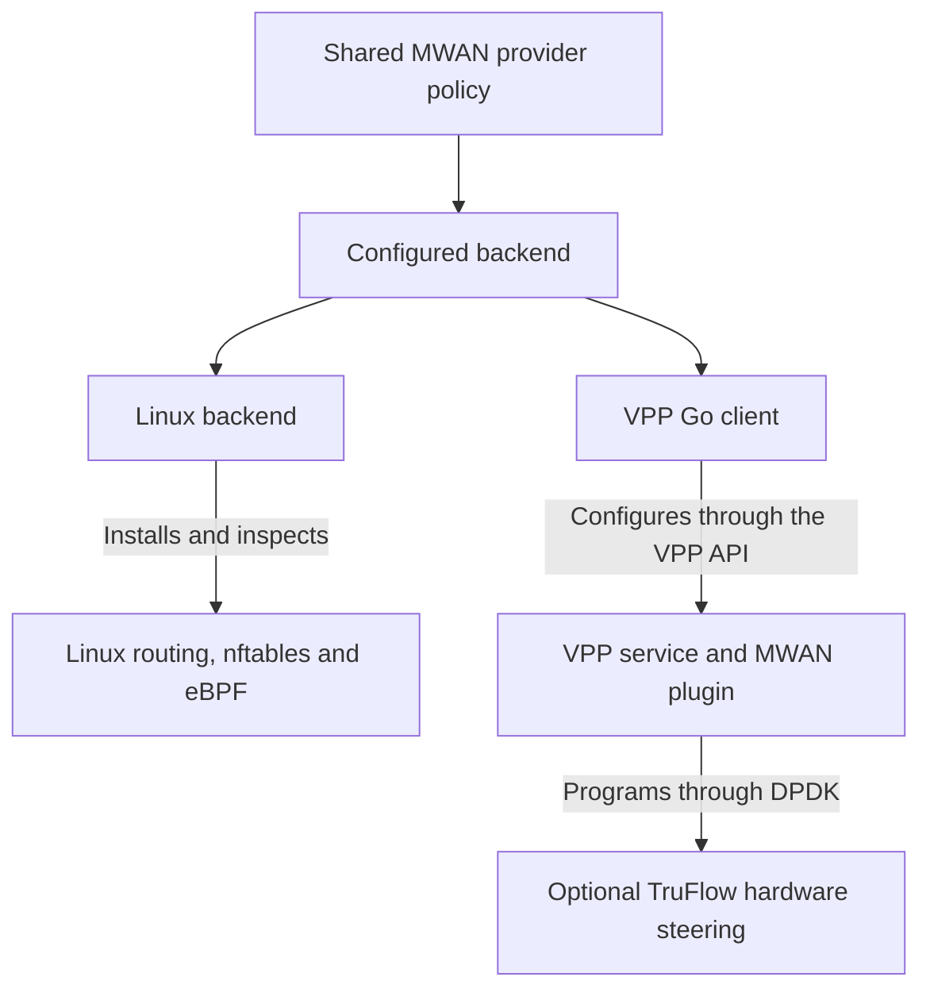

# Packet-processing backends

This proposed design lets the same MWAN release binary configure Linux
forwarding on Vault and VPP with optional TruFlow steering on PowerEdge. A
backend installs and inspects the packet-processing state requested by MWAN's
shared provider policy. Configuration selects the backend at startup.

The design preserves MWAN's provider selection, IPv4 translation, IPv6 prefix
translation, and gateway protection. OPNsense retains the responsibilities in
the [router architecture](opnsense.md), including the LAN firewall and NAT64.

## Select the implementation at runtime

Compile both Go backend implementations into each supported release artifact.
Linux mode must start and operate without VPP, DPDK, a Broadcom adapter, or the
VPP plugin installed. VPP mode connects to a separately installed VPP service
through [GoVPP](https://github.com/FDio/govpp). The MWAN executable does not link
DPDK through cgo or load Go plugins.

The alternatives differ in how much existing control code they can reuse.

Architecture choices:

| Approach | Decision | Consequence |
| --- | --- | --- |
| Built-in Linux and VPP clients, with Linux Control Plane integration for VPP | Recommended | Preserve Linux protocol clients and route ownership, then verify the mirrored VPP state. The route-mirroring defects below must be fixed before acceptance. |
| Built-in clients with direct VPP route writers | Alternative | Avoid route mirroring, but implement separate ownership and priority handling for configured and learned routes, plus host protocol integration. |
| DPDK packet processing inside the Go executable through cgo | Rejected for this design | Add native device and worker lifecycle responsibilities to MWAN and replace facilities already provided by VPP. |

These arrows show configuration ownership, not a packet forwarding path.



## Configure the backend once

Extend the existing steering-group YANG model and typed network loader. The
selection applies to the gateway's forwarding instance, including its
internal attachment and provider interfaces. Do not select different engines
for individual packets or infer the engine from a hostname.

Proposed network settings:

| Setting under `packet-processing` | Values | Contract |
| --- | --- | --- |
| `backend` | `linux`, `vpp` | Omission preserves existing Linux behavior. An explicit unsupported value fails validation. |
| `hardware-steering` | `disabled`, `preferred`, `required` | Default to `disabled`. Linux initially accepts only `disabled`. VPP reports requested and active steering separately. |
| `attachments` | Stable connection IDs and the internal attachment | Map each attachment to its data device and Linux control interface. Validate exclusive device ownership and every referenced next hop. |

The proposed JSON extends the existing configuration representation.

```json
{
  "ietf-interfaces:interfaces": {
    "goodkind-mwan-steering:steering-group": {
      "packet-processing": {
        "backend": "vpp",
        "hardware-steering": "required"
      }
    }
  }
}
```

This fragment shows backend policy. A complete VPP configuration also supplies
the attachment mappings from deployed device inventory. Persist stable device
identities, not VPP interface indexes or DPDK port numbers that can change
after restart. Resolve those runtime indexes during attachment inspection.

Keep the VPP API socket and connection deadlines in the existing TOML process
configuration. Keep network policy in the single representation defined by
the [configuration contract](superpowers/wanconfig/config.md). Configs deploys
the selected VPP package and device assignments through its existing OpenTofu
workflow. The daemon does not change firmware or rebind an arbitrary PCI device.

Example deployment choices:

| Gateway | Backend | Hardware steering | Additional runtime |
| --- | --- | --- | --- |
| Vault | `linux` | `disabled` | Existing Linux dependencies |
| PowerEdge software comparison | `vpp` | `disabled` | VPP and the compatible MWAN plugin |
| PowerEdge accelerated configuration | `vpp` | `required` | VPP, the compatible plugin, and verified TruFlow device support |

## Separate policy from backend state

Keep provider identity, tiers, weights, health, prefix resolution, and family
eligibility in shared Go code. Reuse the existing translation configuration
types and connection IDs. Promote the existing shared provider projection
when a common runtime type is needed instead of copying its fields into a
second provider model.

The current [module composition](../gateway/cmd/mwan/ifmgr_module_configs.go)
configures several independent Linux writers. Replacing only NPT's private
translator interface would leave steering, filtering, route inspection, and
IPv4 NAT dependent on Linux forwarding. Backend selection must cover those
operations together.

The following operations form the proposed internal backend contract.

| Operation | Required behavior |
| --- | --- |
| Validate | Validate static configuration without waiting for devices. Check attachment ownership, API compatibility, and required runtime capabilities before enabling forwarding. |
| Prepare | After early host protection, establish control interfaces and VPP protective packet policy while ordinary forwarding remains disabled. |
| Reconcile | Apply typed provider, route, translation, selection, and protection intent within the caller's ownership scope. Return the applied revision and observed failures. |
| Inspect | Read effective forwarding state, attachment identity, counters, and the active service generation. Report missing or incompatible state. |
| Withdraw | Remove only the specified owner's state after excluding affected provider families. |
| Close | Release the Go client's resources without deleting a working forwarding configuration during an ordinary controller restart. |

Keep BPF map layouts, nftables expressions, VPP indexes, and DPDK handles
inside their adapters. Extend the existing `wanstate.Snapshot` for observed
backend state. Do not use an observed snapshot as desired configuration.

## Preserve Linux protocol access and route ownership

Use VPP's [Linux Control Plane integration](https://docs.fd.io/vpp/25.02/developer/plugins/lcp.html)
to pair each VPP data interface with a Linux TAP or TUN interface. Existing
DHCP, router discovery, neighbor discovery, probes, and BGP sockets use those
control interfaces. Ordinary forwarded traffic uses VPP.

Linux remains authoritative for control-interface addresses, neighbors, and
route intent. The scoped `linux_nl` integration mirrors that state into VPP.
GoVPP must not independently write the routes owned by this mirror. Validate
that imported next hops belong to paired interfaces and that unrelated
management interfaces remain outside the forwarding instance.

The [BGP FIB](../gateway/internal/bgp/fib.go) already separates accepted-path
logic from its private route writer. Inject a backend-aware writer into both
the downstream agent and the upstream session constructor. Preserve their
existing learned-route ownership. In VPP mode, installation and `Installed`
must verify the effective VPP route as well as the Linux control route.

Apply the same backend verification to provider defaults, configured routes,
connected and local addresses, and return routes. A successful Linux write
does not establish VPP readiness. Missing mirror state must trigger explicit
replacement or replay even when the Linux route has not changed.

The pinned [VPP route mirror](https://github.com/FDio/vpp/blob/v26.06/src/plugins/linux-cp/lcp_router.c)
has compatibility gaps that prevent treating it as a complete Linux routing
replacement.

Required route-mirror corrections:

| Observed behavior | Required result |
| --- | --- |
| It narrows Linux route priority to an unsigned byte. MWAN's BGP unreachable covering routes use metric `1024`. | Preserve full-width Linux priority ordering, including the covering routes. Map ordered priorities to native preferences without truncation and rebuild the affected prefix when that ordering changes. Reject an unrepresentable configuration before activation. |
| It gives static and dynamic routes different VPP source priorities. | Preserve Linux's effective choice when static and BGP routes compete for the same prefix. A higher-priority VPP source must not override a better Linux metric. |
| IPv6 deletion removes the prefix's whole VPP source contribution. | Deleting one Linux route preserves every surviving sibling route and next hop. |
| Linux routes can remain present while VPP state is absent. | Detect the mismatch, exclude the affected family, replay the mirror, and verify the repair before restoring eligibility. |
| Policy-rule selection is separate from route mirroring. | Implement MWAN's selection policy explicitly in VPP. Mirroring route tables does not replace connection affinity or provider pins. |
| Local, connected, and unsupported route types require different handling. | Verify local and connected state from address synchronization and reject unsupported route behavior before enabling that configuration. |

## Preserve packet behavior

Both backends implement the existing [translation contract](superpowers/wanconfig/translation.md)
and [gateway protection contract](firewall.md). VPP acceptance requires the
configured IPv4 behavior as well as IPv6 NPT. Enabling VPP must not silently
omit masquerade, static mappings, local-address exceptions, or filtering.

The VPP selector must honor the configured random, source-address, and
source-plus-destination modes, weights, tiers, provider pins, and family
eligibility. It must preserve established connection assignments under the
same conditions as Linux. Native VPP five-tuple hashing alone does not meet
that contract. Any connection-assignment cache belongs to selection and must
not make reverse NPT translation depend on prior outbound traffic.

Compile VPP packet policy from shared typed intent. Linux nftables protects
host control traffic, but it cannot establish protection for packets that
VPP forwards without Linux hooks. VPP must install and inspect its own
forwarding protection before a provider becomes eligible.

The stock [NPT binding API](https://github.com/FDio/vpp/blob/v26.06/src/plugins/npt66/npt66.api)
provides interface bindings but does not expose MWAN's exception policy or a
binding dump. Extend the typed API and implementation where required for
exceptions, inspection, hairpin behavior, and revision replacement. Include
the tested checksum correction until an accepted upstream version supplies
it. The [PowerEdge experiments](https://github.com/agoodkind/mwan/pull/237)
establish benchmark behavior, not full backend compatibility.

## Integrate TruFlow through VPP

Keep hardware steering separate from the forwarding backend. VPP performs
prefix translation on the CPU in the demonstrated configuration. Report
translation offload as inactive until a separate implementation and packet
proof establish it.

VPP's existing [DPDK flow implementation](https://github.com/FDio/vpp/blob/v26.06/src/plugins/dpdk/device/flow.c)
uses ingress flow rules and exposes queue, drop, RSS, and mark actions. It does
not implement the transfer-domain port-to-port rules used by the benchmark.
Add the required C extension within the VPP service, using the existing DPDK
device lifecycle and [BNXT TruFlow API](https://doc.dpdk.org/guides-26.03/nics/bnxt.html#generic-flow-offload).
Do not run a production `testpmd` controller or initialize another DPDK owner
for the same device.

The extension accepts typed steering intent through VPP's binary API. It
resolves the configured physical function, trusted control VF, and represented
ports within the owned switch domain. Go does not submit raw DPDK structures.

Hardware-rule operations:

| Operation | Contract |
| --- | --- |
| Validate | Check the complete match/action combination with `rte_flow_validate`, including the actual device and driver mode. |
| Install | Create rules with `rte_flow_create` and associate each handle with its owner, desired revision, and VPP service generation. |
| Inspect | Report rule identity, native errors, device state, and `rte_flow_query` counters. Preserve packet-test evidence separately from API acceptance. |
| Remove | Destroy only owned handles with `rte_flow_destroy`. Flush only an exclusively owned control port after proving the scope. |
| Recover | Discard invalid handles after port or service restart, rebuild owned rules, and verify forwarding before restoring eligibility. |

Steering rules must preserve the VPP processing path and downstream firewall
path. A rule that bypasses required translation or filtering is invalid.
Keep device-wide resets and firmware changes in deployment ownership under
the existing [interface contract](interfaces.md).

## Handle failures and changes explicitly

Readiness depends on actual backend state for each provider and address family.
Install the existing early Linux protection from validated local configuration
before waiting for VPP, device discovery, or protocol sessions. Ordinary service
readiness retains the existing protection and local-setup conditions. VPP
attachment and forwarding readiness follow separately after device discovery.
This prevents a startup dependency between the early interface-manager service
and a VPP service that needs discovered devices.

Lifecycle behavior:

| Event | Required behavior |
| --- | --- |
| VPP startup | Preserve early Linux host protection and keep VPP forwarding disabled until host pairing, protection, required routes, translation, and selection pass inspection. |
| Prefix, policy, or provider change | Exclude affected families while replacing dependent state. Remove obsolete translation and hardware state before releasing their addresses or devices. |
| Partial software or hardware update | Retain the last verified revision where it remains valid. Otherwise keep the affected family unavailable and return the specific failure. Do not claim a transaction across VPP and hardware. |
| Hardware steering unavailable with `required` | Keep the affected family unavailable. Report the rejected rule or missing capability. |
| Hardware steering unavailable with `preferred` | Continue in VPP only after verifying a working path without the hardware rules. A failed software path also makes the family unavailable. |
| Go controller restart | Inspect and adopt the installed state before reconciling. Preserve working VPP state during the restart. |
| VPP API disconnect or VPP restart | Report unknown or unavailable backend state, preserve valid installed state when possible, and inspect or replay after reconnect. A new VPP generation invalidates cached indexes and handles. |
| Backend selection change | Use a controlled ownership transfer with forwarding excluded until the replacement passes inspection. Do not promise connection-state migration between engines. |

`preferred` permits a verified VPP software path. It does not permit an
automatic switch to the Linux backend.

## Publish truthful state and package optional dependencies

Publish the configured backend, active backend, service generation, applied
revision, required capabilities, failed dependency, and hardware-steering
status through the existing read-only management model. Keep hardware
steering and translation offload as distinct observations.

The existing [translation publication](../gateway/cmd/mwan/wanconfig_livestate.go)
reports `kernel-present`. Preserve its literal meaning. Add backend-neutral
realization fields instead of reporting VPP-only state as installed kernel
rules.

Release the Go client with both backend implementations. Install VPP and the
C plugin only for VPP deployments, with a compatibility manifest covering
the VPP API, plugin, DPDK driver, and required firmware capabilities. Reject
an incompatible manifest before enabling data interfaces. Use generated API
bindings and typed replies rather than parsing VPP CLI output.

## Prove backend acceptance

These checks define implementation acceptance. The specification itself does
not enable VPP or change either host.

Acceptance evidence:

| Area | Required proof |
| --- | --- |
| Portable binary | Run the identical release artifact on a Linux-only gateway without VPP packages and on a VPP gateway. Verify both configured backends. |
| Control protocols and device ownership | Exercise DHCP, renewal, RA/SLAAC, ND, probes, BGP, and local traffic on paired interfaces. Verify that unowned devices and management traffic remain unaffected. |
| Routing | Add and withdraw learned and configured routes. Test full-width priorities, competing static and BGP routes, sibling IPv6 deletion, unreachable covering routes, mirror loss, replay, and effective VPP readback. |
| Selection | Verify every configured selection mode, unequal weights, connection affinity, provider pins, tier fallback, and independent family failure. |
| Translation and protection | Exercise both configured address families, static-map precedence, unsolicited inbound NPT, checksum edge cases, differing prefix lengths, exceptions, hairpin traffic, ICMP errors, and filtering. |
| Lifecycle | Boot with VPP delayed or unavailable and verify early host protection. Restart the Go controller and VPP separately, delete owned state, expire prefixes, reject an unsupported rule, and verify cleanup and readiness. |
| TruFlow | Demonstrate matching hardware-counter increments and controlled rule removal/recovery without bypassing VPP. Test required and preferred behavior separately. |
| Performance | Compare Linux, VPP, and VPP with verified steering under the same packet workload. Report TCP, UDP, packet loss, latency, summed CPU usage, polling cost, and traffic-generator cost in tables. |

VPP becomes a selectable production backend only after the complete
configured feature set passes these checks. Keep implementation and rollout
changes separate from the performance-document PR.
