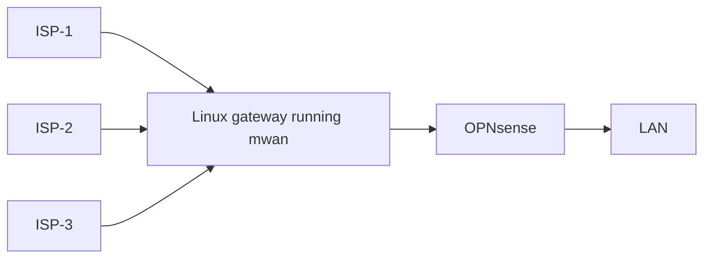

# MWAN

MWAN is Linux gateway software that configures interfaces, addresses, routes,
firewall policy, NAT44, NPTv6, WAN health, and provider selection. OPNsense
remains the LAN firewall.

This overview explains how the gateway manages provider paths and exposes
local status and control.

## Why it was built

OPNsense gateway groups require explicit gateway choices in firewall rules
that otherwise use the default route. Small rule or group changes can then
interrupt internet access. Gateway group failures in this deployment were
also difficult to diagnose.

MWAN moves provider selection to Linux. OPNsense keeps its ordinary firewall
rules. MWAN uses Linux networking interfaces and nftables to manage provider
paths.

## How it works today

The gateway can use multiple providers. These ISP labels are examples.

## Components

- [Configuration and interfaces](#configuration-and-interfaces)
- [Provider health and steering](#provider-health-and-steering)
- [Firewall and translation](#firewall-and-translation)
- [BGP and the gateway API](#bgp-and-the-gateway-api)
- [Management and diagnostics](#management-and-diagnostics)

## Configuration and interfaces

The interface manager reads the network document from `/etc/mwan/network.json`.
Each provider sets:

- Its link and addresses define the network attachment.
- Its translation and health checks define usable paths.
- Its preference tier and weight control provider selection.

The interface manager validates the JSON against its YANG schema, then
reconciles interfaces, routes, and packet policy. The network document selects
providers and sets their health, translation, and routing policy.

The model uses [RFC 8343 for interfaces](https://www.rfc-editor.org/rfc/rfc8343),
[RFC 8344 for IP addresses](https://www.rfc-editor.org/rfc/rfc8344),
[RFC 8349 for routing](https://www.rfc-editor.org/rfc/rfc8349), and
[RFC 8512 for translation](https://www.rfc-editor.org/rfc/rfc8512).
The [local steering model](superpowers/wanconfig/model.md) adds provider
settings. BGP peers and credentials still use TOML.

## Provider health and steering

The interface manager checks each provider's IPv4 and IPv6 paths against
configured failure and recovery thresholds. The gateway assigns new
connections in the first available preference tier only when health, routing,
and translation are ready for that family. IPv4 failure does not disable a
working IPv6 path, or vice versa.

OPNsense can mark a packet with a Differentiated Services Code Point (DSCP)
to request a specific provider. MWAN maps that value to a routing table. A
connection keeps its provider choice.

## Firewall and translation

The interface manager installs a protective firewall baseline before it
loads the rest of the gateway configuration. It reconciles filtering, IPv4
translation, and IPv6 prefix translation with nftables.

| Family | Translation |
| --- | --- |
| IPv4 | MWAN preserves, masquerades, or statically maps source addresses. |
| IPv6 | MWAN preserves or translates source prefixes. |

The current Network Prefix Translation (NPTv6) implementation accepts
canonical prefixes no longer than /64. When a provider uses delegated NPTv6,
a missing delegation disables that provider's IPv6 path.
The [packet example](mwan-example.md) shows translation and provider
selection with illustrative addresses.

## BGP and the gateway API

The `mwan agent` process runs Border Gateway Protocol (BGP) sessions and
serves the local gateway API. The agent installs configured Linux routes and
advertises configured prefixes to its BGP peers. Forwarding-readiness checks
gate announcements when the gateway configures a readiness socket.

With BGP Graceful Restart enabled, the agent can stop without withdrawing its
default route immediately. Without it, the agent withdraws routes before a
controlled stop.

## Management and diagnostics

The interface manager can publish configuration and live state through a
read-only YANG management surface. The agent listens on its configured TCP
address and can also listen on a Unix socket when `agent.socket_path` is set.
The API reports local health, system information, configuration state, events,
and BGP status. Its route controls announce or withdraw routes through the
local BGP speaker. The `mwan.v1` service exposes these RPCs:

| RPC | Operation |
| --- | --- |
| `GetHealth` | Reports local gateway health. |
| `Ping` | Runs a probe from the gateway. |
| `GetConfigState` | Reports configuration hashes and the file manifest. |
| `GetSystemInfo` | Reports local system information. |
| `WatchEvents` | Streams configuration and health events. |
| `GetBGPStatus` | Reports local BGP status. |
| `AnnounceRoutes` | Resumes route announcements after readiness checks. |
| `WithdrawRoutes` | Withdraws routes and records the manual withdrawal state. |

The agent and interface manager write structured logs to standard output and
the systemd journal. Their configured log files provide an additional local
copy.
