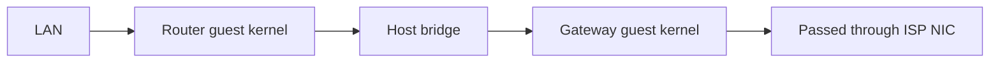
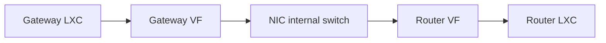

# MWAN packet forwarding performance

MWAN forwards packets in the guest kernel. Routes, policy rules, and nftables
rules do not send packet bytes to the daemon. A host bridge uses host CPU to
transfer packets between router and gateway guests. A NIC can instead switch
packets between hardware virtual functions assigned to separate containers.

OPNsense [requires disabled hardware offloads in IPS mode](https://docs.opnsense.org/manual/ips.html).
OPNsense [disables several NIC offloads by default](https://docs.opnsense.org/manual/interfaces_settings.html)
and [disables system-wide receive-side scaling by default](https://docs.opnsense.org/troubleshooting/performance.html).

## Attachment paths

The WAN attachment and the router attachment are independent. These diagrams
show PCI passthrough, virtual WAN, host bridge, and hardware virtual-function
attachment.

### ISP NIC passed to the gateway

PCI passthrough assigns the physical NIC to the gateway guest. The WAN
attachment does not use a host bridge for packet transfer.

### ISP NIC attached to the host

A virtual WAN attaches the ISP NIC to the host. The host transfers packets
between that NIC and the gateway guest.

### Router and gateway on one host bridge

Separate router and gateway guests use the host bridge for their shared
attachment. PCI passthrough on a WAN NIC does not remove this transfer.

In the architecture example, ISP-1 and ISP-2 use PCI passthrough. ISP-3 uses a
virtual WAN. Every packet between the router and gateway guests uses their
host bridge.

### Router and gateway on hardware virtual functions

The XR11 uses Single Root I/O Virtualization (SR-IOV) to assign each
container a virtual function (VF), a separate PCI interface on the NIC. The
NIC switches packets between VFs while the host kernel runs the container
network stacks and handles interrupts.

## Measurement on August 16, 2026

| Scope | Evidence |
| --- | --- |
| Client connection | ISP-1 public speed test |
| Faster links | The test did not exercise faster links. |
| Download bottleneck | The test did not isolate the bottleneck. |

| Measurement | Result |
| --- | ---: |
| Client download | 693 Mbit/s |
| Client upload | 1782 Mbit/s |
| Host CPU cores | 12 |

| CPU, % of recorded host | Before test | Upload peak |
| --- | ---: | ---: |
| Router guest copy thread | 0.08% | 4.92% |
| Gateway guest copy thread | 0.08% | 4.33% |
| Both copy threads | 0.17% | 9.25% |
| Router guest forwarding | Not measured | 37.83% |
| Gateway guest forwarding | Not measured | 16.75% |
| Both guests forwarding | Not measured | 54.58% |
| Forwarding and copy threads | Not measured | 63.83% |

## XR11 measurement on October 17, 2026

The VF benchmark measures endpoint traffic between the containers through
the NIC's internal switch.

| Claim | Boundary | Basis |
| --- | --- | --- |
| Routed capacity | Unmeasured | Endpoints used the VF transit subnet. |
| Forwarding latency | Unmeasured | The test did not use routed probes. |
| Forwarding CPU cost | Not isolated | CPU includes endpoint work. |
| Per-feature gain | Not isolated | Four offloads changed together. |
| UDP loss cause | Unidentified | The test did not trace lost datagrams. |
| Bridge CPU savings | Unmeasured | The test did not use a host bridge. |
| BPF hardware offload | Unverified | The test did not inspect NIC execution. |

### Test conditions

| Condition | Value |
| --- | --- |
| Host | Dell PowerEdge XR11 |
| CPU | Intel Xeon Silver 4309Y |
| CPU topology | 8 cores, 16 logical CPUs |
| Each container’s CPU allocation | 12.50% of host capacity |
| Kernel | Proxmox `7.0.14-20-pve` |
| NIC | Broadcom BCM57504 |
| Driver | `bnxt_en` |
| NIC firmware | `236.1.173.0/pkg 36.11.73.00` |
| Physical function | `0000:19:00.1` |
| `nic1` link | The port did not detect a cable before or after tests. |
| UTC interval | 05:46 to 05:54 |
| Pacific date | October 16, 2026 |
| Tool | `iperf3` 3.18 |
| Process placement | Container network namespace and cgroup |
| VF MTU | 1500 bytes |
| TCP streams | 8 per direction, except the single-stream test |
| UDP streams | 4 at 2.5 Gbit/s each |
| UDP datagram size | 1400 bytes |
| Warmup | 3 seconds |
| CPU sampling | 1-second host and cgroup samples; first 4 omitted |
| Host CPU accounting | Includes all host work; does not subtract idle use |

| Container | Role | CPUs | VF (`mwanbr`) | Physical port |
| --- | --- | --- | --- | --- |
| 313 | WAN | 1-2 | `0000:1a:01.0` | 2 (`wan`) |
| 314 | LAN | 13-14 | `0000:1a:01.1` | 0 (`lan`) |

### Endpoint throughput and CPU use

The endpoint tests generate and receive traffic in the containers. They do
not measure routed forwarding. Receiver throughput excludes warmup, while driver counter deltas
cover the complete run. Every CPU column uses total host capacity as its
denominator.

#### TCP direction and stream count

| Workload | Duration | Forward, Gbit/s | Reverse, Gbit/s | WAN container CPU | LAN container CPU | Host CPU |
| --- | ---: | ---: | ---: | ---: | ---: | ---: |
| Single TCP stream | 30 s | 47.87 | 0.00 | 10.60% | 5.88% | 20.29% |
| Parallel TCP | 60 s | 66.13 | 0.00 | 12.48% | 11.27% | 27.40% |
| Reverse parallel TCP | 60 s | 0.00 | 69.74 | 12.38% | 12.24% | 28.93% |

#### Bidirectional TCP and offloads

The re-enabled run also enabled `tx-tcp-mangleid-segmentation`. The initial
settings repeat restored that flag to its original value. The comparison
changes several offloads together and does not isolate a single feature.

| VF configuration | Duration | Forward, Gbit/s | Reverse, Gbit/s | Combined, Gbit/s | WAN container CPU | LAN container CPU | Host CPU |
| --- | ---: | ---: | ---: | ---: | ---: | ---: | ---: |
| Initial settings | 60 s | 31.31 | 30.42 | 61.73 | 12.18% | 12.49% | 27.84% |
| Segmentation and aggregation disabled | 30 s | 7.77 | 9.07 | 16.84 | 9.39% | 9.45% | 35.91% |
| Segmentation and aggregation re-enabled | 60 s | 32.79 | 31.53 | 64.33 | 12.40% | 12.48% | 28.21% |
| Initial settings repeat | 30 s | 32.59 | 27.91 | 60.50 | 12.21% | 12.49% | 28.33% |

#### UDP stress

| Workload | Duration | Received, Gbit/s | WAN container CPU | LAN container CPU | Host CPU |
| --- | ---: | ---: | ---: | ---: | ---: |
| Parallel UDP | 30 s | 9.54 | 12.49% | 6.37% | 23.50% |

### Offloads

The current settings match the initial and final runs on both VFs and the
physical interfaces. TSO splits outgoing TCP buffers into packets in the NIC,
while GSO provides software segmentation. GRO combines received packets,
and hardware GRO performs receive aggregation in the NIC.

| Feature | Current | VF disabled | VF re-enabled |
| --- | --- | --- | --- |
| Receive and transmit checksum offload | On | On | On |
| Scatter-gather | On | On | On |
| TCP segmentation offload (TSO) | On | Off | On |
| Generic segmentation offload (GSO) | On | Off | On |
| Generic receive offload (GRO) | On | Off | On |
| Hardware GRO | On | Off | On |
| Receive hashing | On | On | On |
| Large receive offload | Off | Off | Off |
| `tx-tcp-mangleid-segmentation` | Off | Off | On |

| Measurement | Result |
| --- | ---: |
| Throughput ratio, first bidirectional / disabled | 3.67 |
| Host CPU decrease, enabled vs disabled | 8.07 percentage points |
| Software interrupt CPU, first bidirectional | 5.81% |
| Software interrupt CPU, disabled | 23.05% |
| Hardware aggregation bytes, single-stream receiver | 191,362,528,254 |
| Idle host CPU, preceding ten-second average | 6.02% |

The [driver's hardware aggregation counter](https://github.com/torvalds/linux/blob/master/drivers/net/ethernet/broadcom/bnxt/bnxt_ethtool.c),
`rx_tpa_bytes`, records bytes combined in the NIC before host processing.

### Packet loss

The receive counters belong to the receiving VF in each TCP test.

| Test | Retransmissions | Receive drops | Buffer errors | Aggregation errors |
| --- | ---: | ---: | ---: | ---: |
| Single stream | 0 | 0 | 0 | 0 |
| Reverse parallel | 19,823 | 12,792 | 5,865 | 33 |

| UDP measurement | Result |
| --- | ---: |
| Offered load | 9.70 Gbit/s |
| Received throughput | 9.54 Gbit/s |
| Datagram loss | 1.6208% |
| Receiver VF drops over the complete run | 200,253 |

## WAN and LAN capacity

The VF interconnect has bulk TCP headroom above the physical-link capacity
with the enabled offload configuration.

| Measurement | Result |
| --- | ---: |
| WAN negotiated rate | 10 Gbit/s full duplex |
| LAN negotiated rate | 10 Gbit/s full duplex |
| Combined WAN-to-LAN and LAN-to-WAN link capacity | 20 Gbit/s |
| Final combined VF throughput | 60.50 Gbit/s |
| Final VF / combined physical-link rate | About 3.03 |

## Remaining investigation

MWAN-527 tracks the forwarding comparison with a software bridge.
