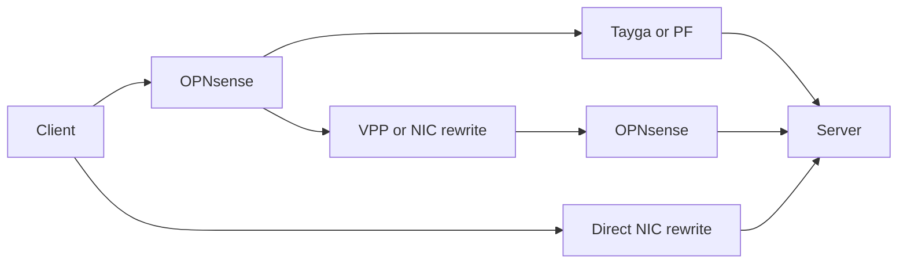

# MWAN packet forwarding performance

MWAN forwards packets in the guest kernel. Routes, policy rules, and nftables
rules do not send packet bytes to the daemon. A host bridge uses host CPU to
transfer packets between router and gateway guests. A NIC can instead switch
packets between hardware virtual functions assigned to separate containers.

CPU usage adds the work across logical CPUs, or hardware threads. Host CPU
includes guest work, traffic generation, and other active host work.

CPU percentage scale:

| Fully busy logical CPUs | Summed CPU usage |
| --- | ---: |
| 1 | 100% |
| 8 | 800% |

OPNsense [requires disabled hardware offloads in IPS mode](https://docs.opnsense.org/manual/ips.html).
OPNsense [disables several NIC offloads by default](https://docs.opnsense.org/manual/interfaces_settings.html)
and [disables system-wide receive-side scaling by default](https://docs.opnsense.org/troubleshooting/performance.html).

## Attachment paths

The WAN attachment and the router attachment are independent. These diagrams
show PCI passthrough, virtual WAN, and host bridge attachment.

### ISP NIC passed to the gateway

PCI passthrough assigns the physical NIC to the gateway guest. The WAN
attachment does not use a host bridge for packet transfer.

### ISP NIC attached to the host

A virtual WAN attaches the ISP NIC to the host. The host transfers packets
between that NIC and the gateway guest.

### Router and gateway on one host bridge

Separate router and gateway guests use the host bridge for their shared
attachment. PCI passthrough on a WAN NIC does not remove this transfer.

In the architecture example, ISP-1 and ISP-2 use PCI passthrough. ISP-3 uses a
virtual WAN. Every packet between the router and gateway guests uses their
host bridge.

## Measurement on August 16, 2026

The upload measurements compare CPU use for routing and NAT inside the router
and gateway guests with the host CPU used to copy packets between those guests.

Test measurements:

| Measurement | Result |
| --- | ---: |
| Download | 693 Mbit/s |
| Upload | 1782 Mbit/s |
| Recorded host CPU capacity | 12 cores |
| Copy threads' share of combined guest work at upload peak | About 15% |

The CPU breakdown distinguishes guest processing from host packet copying.

Host CPU use:

| CPU usage, summed across logical CPUs | Before test | Upload peak |
| --- | ---: | ---: |
| Router guest copy thread | 1.00% | 59.00% |
| Gateway guest copy thread | 1.00% | 52.00% |
| Both copy threads | 2.00% | 111.00% |
| Router guest forwarding | Not measured | 454.00% |
| Gateway guest forwarding | Not measured | 201.00% |
| Both guests forwarding | Not measured | 655.00% |
| Forwarding and copy threads | Not measured | 766.00% |

## Vault and PowerEdge translation performance

The comparison evaluates PowerEdge translation options against Vault's
installed OPNsense router under the recorded workload and CPU allocations.

Test conditions:

| Test condition | Value |
| --- | --- |
| Host CPU capacity | Vault: 12 logical CPUs, maximum 1200%; PowerEdge: 16 logical CPUs, maximum 1600% |
| OPNsense VM allocation | Vault: 4 vCPUs, maximum 400%; PowerEdge: 8 vCPUs, maximum 800% |
| Traffic | 8 clients; TCP: 4 streams each, uncapped; UDP: 1 stream each, 1400-byte payload, 5 Gbit/s per direction |
| Measured duration | 20 seconds; TCP excludes 3 seconds of warmup |
| Network | Vault uses its physical LAN; PowerEdge uses the NIC internal switch. |
| Traffic generator | iperf3 3.18 with synchronized UDP starts |
| Generator placement | PowerEdge runs both endpoints. Vault uses NAS as its client and runs the server locally. |
| Recorded PowerEdge WAN and LAN links | 10 Gbit/s full duplex each, from iDRAC NIC inventory. |
| PowerEdge NIC and drivers | Broadcom BCM57504; OPNsense uses a rebuilt Broadcom driver. The DPDK build includes the [submitted BNXT firmware-command fix](https://patches.dpdk.org/project/dpdk/patch/20261018022929.91865-1-alex@goodkind.io/). |
| PowerEdge software settings | TruFlow enabled; VF MSI-X capacity 16; OPNsense uses 8 queues and VPP uses 4. |
| NIC test settings | TruFlow enabled; VF MSI-X capacity 16; OPNsense uses 8 queues. |
| Hardware scope | Fixed address mappings, with a separate source address per client; PF NAT66 combines sources. The tested driver rejects NAT64. |
| VPP driver mode | VPP performs CPU translation and uses [app-id=255](https://github.com/DPDK/dpdk/blob/v26.03/drivers/net/bnxt/bnxt.h#L895-L896) to disable TruFlow for its interfaces. |
| Tayga UDP timing | Recorded interval: 46.57 s. Required interval: 18 to 22 s. |

Efficiency divides combined received Mbps by summed routing/translation CPU
percentage points, using the rounded measurements in these comparison tables.

TCP tests compare transfer capacity without a sender rate limit.
UDP tests compare packet delivery under the same requested load.

### NAT64

TCP throughput and CPU use:

| Host | Translation | Software | Received Gbit/s, forward / reverse | Routing / translation CPU | Total host CPU | Mbps per routing / translation CPU percentage point |
| --- | --- | --- | --- | --- | --- | --- |
| Vault | NAT64 | Tayga | 0.93 / 0.35 | 442.80% | 908.28% | 2.89 |
| PowerEdge | NAT64 | Tayga | 1.28 / 1.48 | 794.08% | 1014.24% | 3.48 |
| PowerEdge | NAT64 | OPNsense + VPP | 4.91 / 5.25 | 1134.40% | 1379.84% | 8.96 |

UDP throughput, loss, and CPU use:

| Host | Translation | Software | Sent Gbit/s | Received Gbit/s | Packets not received | Routing / translation CPU | Total host CPU | Mbps per routing / translation CPU percentage point |
| --- | --- | --- | --- | --- | --- | --- | --- | --- |
| Vault | NAT64 | Tayga | Test failed | Test failed | Test failed | Not measured | Not measured | Not measured |
| PowerEdge | NAT64 | Tayga | Invalid timing | Invalid timing | Invalid timing | Not measured | Not measured | Not measured |
| PowerEdge | NAT64 | OPNsense + VPP | 5.00 / 5.00 | 1.03 / 1.16 | 79.35% / 76.79% | 1125.44% | 1576.64% | 1.95 |

### NAT66

TCP throughput and CPU use:

| Host | Translation | Software | Received Gbit/s, forward / reverse | Routing / translation CPU | Total host CPU | Mbps per routing / translation CPU percentage point |
| --- | --- | --- | --- | --- | --- | --- |
| Vault | NAT66 | PF | 2.35 / 0.28 | 347.64% | 855.96% | 7.57 |
| PowerEdge | NAT66 | PF | 10.22 / 11.29 | 777.92% | 1163.84% | 27.65 |
| PowerEdge | NAT66 | OPNsense + VPP | 5.10 / 5.64 | 1150.40% | 1385.76% | 9.34 |
| PowerEdge | Fixed NAT66 | OPNsense + TruFlow | 6.27 / 5.92 | 776.64% | 1044.48% | 15.70 |
| PowerEdge | Fixed NAT66 | TruFlow without OPNsense | 31.81 / 36.97 | 0.1040% | 1540.00% | Controller only |

UDP throughput, loss, and CPU use:

| Host | Translation | Software | Sent Gbit/s | Received Gbit/s | Packets not received | Routing / translation CPU | Total host CPU | Mbps per routing / translation CPU percentage point |
| --- | --- | --- | --- | --- | --- | --- | --- | --- |
| Vault | NAT66 | PF | 2.53 / 5.00 | 1.72 / 1.06 | 31.15% / 78.78% | 367.68% | 1098.84% | 7.56 |
| PowerEdge | NAT66 | PF | 5.00 / 5.00 | 4.58 / 3.21 | 8.39% / 35.86% | 768.96% | 1475.52% | 10.13 |
| PowerEdge | NAT66 | OPNsense + VPP | 5.00 / 5.00 | 2.88 / 1.11 | 42.11% / 77.84% | 1093.76% | 1577.44% | 3.65 |
| PowerEdge | Fixed NAT66 | OPNsense + TruFlow | 5.00 / 5.00 | 3.70 / 3.60 | 25.96% / 27.96% | 779.20% | 1464.00% | 9.37 |
| PowerEdge | Fixed NAT66 | TruFlow without OPNsense | 5.00 / 5.00 | 4.99 / 4.99 | 0.13% / 0.16% | 0.0816% | 897.60% | Controller only |

### NPT

TCP throughput and CPU use:

| Host | Translation | Software | Received Gbit/s, forward / reverse | Routing / translation CPU | Total host CPU | Mbps per routing / translation CPU percentage point |
| --- | --- | --- | --- | --- | --- | --- |
| Vault | NPT | PF BINAT | 2.33 / 0.22 | 347.40% | 864.24% | 7.34 |
| PowerEdge | NPT | PF BINAT | 10.10 / 10.86 | 774.56% | 1139.20% | 27.06 |
| PowerEdge | NPT, RFC 6296 | OPNsense + VPP | 5.32 / 5.37 | 1160.00% | 1390.08% | 9.22 |
| PowerEdge | Fixed NPT | OPNsense + TruFlow | 6.44 / 5.74 | 774.24% | 1041.28% | 15.73 |

UDP throughput, loss, and CPU use:

| Host | Translation | Software | Sent Gbit/s | Received Gbit/s | Packets not received | Routing / translation CPU | Total host CPU | Mbps per routing / translation CPU percentage point |
| --- | --- | --- | --- | --- | --- | --- | --- | --- |
| Vault | NPT | PF BINAT | 2.35 / 5.00 | 1.27 / 1.17 | 45.50% / 76.66% | 335.52% | 1155.84% | 7.27 |
| PowerEdge | NPT | PF BINAT | 5.00 / 5.00 | 4.60 / 4.69 | 8.05% / 6.29% | 764.80% | 1491.20% | 12.15 |
| PowerEdge | NPT, RFC 6296 | OPNsense + VPP | 5.00 / 5.00 | 2.57 / 2.75 | 48.60% / 45.04% | 1049.12% | 1574.72% | 5.07 |
| PowerEdge | Fixed NPT | OPNsense + TruFlow | 5.00 / 5.00 | 2.95 / 3.24 | 40.91% / 35.17% | 771.52% | 1427.36% | 8.02 |

Rate pairs list simultaneous traffic from client to server and from server to
client, in that order. Routing/translation CPU combines OPNsense with its
external translator or NIC rule controller, except that the direct NIC test
counts only its controller.

PF BINAT replaces the prefix and updates checksums, while VPP applies the
different [RFC 6296 address calculation](https://www.rfc-editor.org/rfc/rfc6296.html).

## PowerEdge whole-prefix translation

These tests compare complete prefix translation with the NIC internal switch
and peer VFs generating traffic. Single-prefix tests use VF1 and VF2. Dual-prefix
tests use separate external prefixes on VF1 and VF2 and one ULA prefix on VF3.

The workload matches the earlier TCP and UDP settings. VPP uses the
[local checksum-fold correction](performance-vpp-checksum.patch) and equal-weight
connection hashing. Linux alternates new connections between WANs and preserves
the assignment, while native OPNsense uses equal-weight multi-WAN. TruFlow
steers packets in the hybrid test while VPP performs prefix translation on the CPU.

Bold software identifies the [NPT translator MWAN uses today](../gateway/internal/ifmgr/modules/npt/bpf/npt.c),
not an exact reproduction of its WAN-selection configuration. Rows sort by
combined received Mbps per summed total-host CPU percentage point within each prefix
policy. Bold rates and efficiency identify the best valid result in each policy.
Kernel means the test did not measure translation CPU separately. Host CPU
includes traffic generation, and VPP CPU includes polling and packet handling.

TCP measures uncapped transfer capacity with simultaneous traffic in both directions.

Single-prefix TCP throughput and CPU use:

| Host | Translation | Software | Received Gbit/s, forward / reverse | Routing / translation CPU | Total host CPU | Mbps per total host CPU percentage point |
| --- | --- | --- | --- | --- | --- | --- |
| PowerEdge | Single prefix | VPP + TruFlow steering | **20.91 / 20.70** | 386.04% | 1221.79% | **34.05** |
| PowerEdge | Single prefix | VPP | 20.36 / 20.98 | 386.16% | 1224.95% | 33.75 |
| PowerEdge | Single prefix | **MWAN eBPF** | 19.71 / 18.86 | Kernel | 1413.34% | 27.29 |
| PowerEdge | Single prefix | nftables | 19.57 / 18.89 | Kernel | 1424.13% | 27.00 |
| PowerEdge | Single prefix | PF BINAT | 13.19 / 12.53 | 779.36% | 1189.90% | 21.61 |

Dual-prefix load-balancing TCP throughput and CPU use:

| Host | Translation | Software | Received Gbit/s, forward / reverse | Routing / translation CPU | Total host CPU | Mbps per total host CPU percentage point |
| --- | --- | --- | --- | --- | --- | --- |
| PowerEdge | Dual, connection | VPP + TruFlow steering | 20.56 / 20.50 | 356.76% | 1355.04% | **30.30** |
| PowerEdge | Dual, connection | VPP | **20.66 / 20.66** | 354.32% | 1378.53% | 29.97 |
| PowerEdge | Dual, connection | MWAN eBPF + nftables software flowtable | 17.56 / 18.23 | Kernel | 1292.24% | 27.69 |
| PowerEdge | Dual, connection | **MWAN eBPF** | 18.09 / 17.95 | Kernel | 1350.39% | 26.69 |
| PowerEdge | Dual, connection | nftables | 17.81 / 18.13 | Kernel | 1352.30% | 26.58 |
| PowerEdge | Dual, connection | PF BINAT | 9.30 / 13.91 | 786.05% | 1200.86% | 19.33 |
| PowerEdge | Dual, connection | OPNsense multi-WAN | 9.68 / 12.14 | 787.38% | 1177.76% | 18.53 |

UDP compares packet delivery at the requested load rather than maximum capacity.
The eBPF packet-selection sender failed its requested forward load. Packet
selection results do not rank as working alternatives for TCP connections.

Single-prefix UDP throughput, loss, and CPU use:

| Host | Translation | Software | Sent Gbit/s | Received Gbit/s, forward / reverse | Packets not received | Routing / translation CPU | Total host CPU | Mbps per total host CPU percentage point |
| --- | --- | --- | --- | --- | --- | --- | --- | --- |
| PowerEdge | Single prefix | VPP | 5.00 / 5.00 | **4.99 / 4.97** | 0.16% / 0.54% | 385.26% | 1201.02% | **8.30** |
| PowerEdge | Single prefix | VPP + TruFlow steering | 5.00 / 5.00 | 4.98 / 4.99 | 0.43% / 0.29% | 381.80% | 1202.43% | 8.29 |
| PowerEdge | Single prefix | **MWAN eBPF** | 4.99 / 5.00 | 4.96 / 4.97 | 0.73% / 0.56% | Kernel | 1286.85% | 7.72 |
| PowerEdge | Single prefix | nftables | 5.00 / 5.00 | 4.96 / 4.93 | 0.87% / 1.32% | Kernel | 1303.06% | 7.59 |
| PowerEdge | Single prefix | PF BINAT | 5.00 / 5.00 | 4.70 / 4.77 | 5.98% / 4.63% | 687.03% | 1444.90% | 6.55 |

Dual-prefix load-balancing UDP throughput, loss, and CPU use:

| Host | Translation | Software | Sent Gbit/s | Received Gbit/s, forward / reverse | Packets not received | Routing / translation CPU | Total host CPU | Mbps per total host CPU percentage point |
| --- | --- | --- | --- | --- | --- | --- | --- | --- |
| PowerEdge | Dual, connection | VPP | 5.00 / 5.00 | 4.99 / 4.93 | 0.24% / 1.33% | 380.11% | 1268.30% | **7.82** |
| PowerEdge | Dual, connection | VPP + TruFlow steering | 5.00 / 5.00 | 4.99 / 4.98 | 0.17% / 0.46% | 380.07% | 1310.33% | 7.61 |
| PowerEdge | Dual, connection | nftables | 5.00 / 5.00 | 4.84 / 4.92 | 3.24% / 1.66% | Kernel | 1310.61% | 7.44 |
| PowerEdge | Dual, connection | **MWAN eBPF** | 5.00 / 5.00 | 4.95 / 4.97 | 0.92% / 0.66% | Kernel | 1345.71% | 7.37 |
| PowerEdge | Dual, connection | MWAN eBPF + nftables software flowtable | 5.00 / 5.00 | **4.98 / 4.99** | 0.32% / 0.22% | Kernel | 1352.90% | 7.37 |
| PowerEdge | Dual, connection | PF BINAT | 5.00 / 5.00 | 4.61 / 4.80 | 7.78% / 3.97% | 726.23% | 1460.08% | 6.45 |
| PowerEdge | Dual, connection | OPNsense multi-WAN | 5.00 / 5.00 | 4.58 / 4.58 | 8.45% / 8.32% | 701.95% | 1435.24% | 6.38 |
| PowerEdge | Dual, packet | nftables | 4.98 / 5.00 | 2.44 / 4.93 | 51.07% / 1.43% | Kernel | 1250.78% | 5.89 |
| PowerEdge | Dual, packet | **MWAN eBPF** | 0.000098 / 5.00 | 0.000049 / 5.00 | 50.29% / 0.05% | Kernel | 546.42% | Forward load failed |

Native command output and packet observations explain the unavailable policies.

Whole-prefix policy attempts:

| Configuration | Observed result |
| --- | --- |
| TruFlow only, single prefix | Source and destination prefix-action validation failed with `Truflow parser does not support act 50` before rule creation. |
| TruFlow only, dual prefixes | Separate source and destination prefix-action attempts produced the same driver rejection. |
| VPP, dual per packet | `set ip6 flow-hash` rejected `per-packet` with `unknown input`. |
| VPP + TruFlow, dual per packet | The separate hybrid attempt produced the same native command rejection. |
| MWAN eBPF, per-packet TCP | The capture showed different external source prefixes for SYN and ACK, and the receiver reset the connection. |
| nftables, per-packet TCP | The separate capture also showed a source-prefix change during connection setup and a receiver reset. |
| PF BINAT, dual per packet | PF accepted the `no state` filter rule but created a UDP translation state with `MULTIPLE:SINGLE`, and the echo timed out. |
| eBPF + software flowtable, dual per packet | The flowtable retained one WAN after connection setup. Disabling only the flowtable restored equal packet alternation. |

### Dual-prefix CPU profiling

The profiled reruns use the same workload with VPP + TruFlow steering and
MWAN's native [Go controller](https://github.com/agoodkind/mwan/blob/b8056e16541c39a484d08113f0ab6fc81ebffff7/cmd/mwan/ifmgr.go).
MWAN uses source-and-destination connection hashing and connected ULA return
routes in both WAN policy tables.

This table reports CPU use as a share of total host capacity, while earlier
tables sum logical CPU usage. MWAN's kernel samples include traffic generation,
while its program and service counters isolate NPT and controller execution.
VPP's routing samples combine lookup and WAN hashing.

Profiled throughput and selected CPU costs:

| Measurement | VPP + TruFlow TCP | MWAN TCP | VPP + TruFlow UDP | MWAN UDP |
| --- | ---: | ---: | ---: | ---: |
| Received Gbit/s, forward / reverse | 20.65 / 20.49 | 18.32 / 17.71 | 4.96 / 4.94 | 4.64 / 4.85 |
| Packets not received | Not applicable | Not applicable | 0.81% / 1.19% | 7.18% / 2.95% |
| Total host CPU | 85.96% | 87.01% | 80.07% | 82.78% |
| Idle host CPU | 29.68% | 6.17% | 29.42% | 6.28% |
| VPP process CPU | 22.60% | Not applicable | 23.50% | Not applicable |
| Receive and polling CPU | 4.17% | Not isolated | 7.33% | Not isolated |
| Transmit CPU | 6.34% | Not isolated | 1.23% | Not isolated |
| Routing and WAN selection CPU | 1.59% | Not isolated | 0.49% | Not isolated |
| NPT execution CPU | 0.87% | 1.55% | 0.33% | 2.51% |
| VPP worker scheduling and packet buffers CPU | 2.38% | Not applicable | 9.13% | Not applicable |
| TruFlow controller or Go daemon CPU | 0.0043% | 0.0125% | 0.0015% | 0.0045% |
| Mbps per total host CPU percentage point | 478.59 | 414.08 | 123.64 | 114.65 |

the Go controller is not consuming substantial CPU, and moving only prefix translation into the NIC would address a relatively small part of VPP’s measured cost.

### Separate routing and WAN hashing

These reruns estimate route lookup and WAN hashing CPU from sampled instruction
addresses in the unchanged optimized VPP build. CPU percentages use total host
capacity.

VPP + TruFlow routing and hashing results:

| Measurement | TCP | UDP |
| --- | ---: | ---: |
| Received Gbit/s, forward / reverse | 20.58 / 20.56 | 4.92 / 4.92 |
| Total host CPU | 85.37% | 79.01% |
| VPP process CPU | 22.33% | 23.75% |
| Route lookup CPU | 0.3696% | 0.1139% |
| WAN hashing CPU | 0.1495% | 0.0382% |
| Forwarding and header rewrite CPU | 0.6417% | 0.1696% |
| Other routing-node CPU | 0.3715% | 0.1340% |
| Other VPP or kernel CPU | 20.7535% | 23.2011% |

## PowerEdge hardware tunnel tests

These tests measure the NIC's outbound address rewriting and VXLAN
encapsulation with one shared public prefix. A fixture preinstalls exact
connection rules and assigns WANs by connection index before traffic starts.

Linux peers generate and receive traffic, decapsulate VXLAN, and enforce the
WAN limits, including headers. Native hardware rules handle every reply.
Total host CPU includes both endpoints and the Linux rate policers.

Process rows include only intervals with complete counter readings. Host
profiling cannot measure work inside the NIC, and kernel function samples
undercounted native process CPU. The table uses direct host, process, and
cgroup counters as shares of total PowerEdge capacity.

Controller service CPU includes the Go rule manager and DPDK testpmd, which
installs the NIC rules.

Outbound throughput and CPU measurements:

| Measurement | Native TCP | VXLAN TCP | Combined TCP | Native UDP | VXLAN UDP | Combined UDP |
| --- | ---: | ---: | ---: | ---: | ---: | ---: |
| Total WAN limit, Gbit/s | 1 | 1 | 2 | 1 | 1 | 2 |
| Underlay / inner MTU, bytes | 1600 / 1500 | 1600 / 1500 | 1600 / 1500 | 1600 / 1500 | 1600 / 1500 | 1600 / 1500 |
| Native / VXLAN data connections | 32 / 0 | 0 / 32 | 16 / 16 | 8 / 0 | 0 / 8 | 4 / 4 |
| Sent Gbit/s | 0.926 | 0.827 | 1.509 | 1.000 | 1.000 | 2.000 |
| Received Gbit/s | 0.922 | 0.823 | 1.505 | 0.967 | 0.923 | 1.890 |
| Packets not received | Not applicable | Not applicable | Not applicable | 3.27% | 7.73% | 5.52% |
| Total host CPU | 9.81% | 10.37% | 11.29% | 20.03% | 20.62% | 27.98% |
| Matched idle host CPU | 6.24% | 6.55% | 5.94% | 6.13% | 6.16% | 6.61% |
| Controller service CPU | 0.0130% | 0.0116% | 0.0122% | 0.0052% | 0.0052% | 0.0052% |
| Observed sender process CPU | 0.52% | 0.42% | 0.78% | 6.91% | 7.53% | 8.91% |
| Observed receiver process CPU | 1.27% | 1.41% | 1.80% | 3.97% | 3.71% | 5.05% |
| Observed profiling process CPU | 0.17% | 0.18% | 0.17% | 0.15% | 0.14% | 0.11% |
| Host counter window coverage | 97.43% | 97.45% | 97.42% | 97.48% | 97.48% | 97.46% |
| Mbps per total host CPU percentage point | 93.93 | 79.32 | 133.33 | 48.30 | 44.75 | 67.54 |

Native command output distinguishes rejected actions from installed rules.

Hardware capability attempts:

| Configuration | Native result |
| --- | --- |
| GRE, TCP and UDP | The installed DPDK driver rejected encapsulation alone with `Truflow parser does not support act 26` and full chains with `Truflow parser does not support act 27`, before throughput tests could start. |
| Hardware per-packet WAN selection, TCP and UDP | The driver rejected RANDOM with `Truflow parser does not support type 69` and rejected SAMPLE ratio two with PMD error type `2`. |
| Physical-ingress reverse VXLAN, without the outer-source match | The TCP and UDP rules installed, but this task did not send physical-ingress traffic. |
| Physical TruFlow address rewrite, LAN and Sonic VFs | Both physical TCP probes timed out after DPDK installed the forward and reverse exact-address rewrite rules with software forwarding stopped. |

## PowerEdge physical Internet tests

The physical tests compare translation software against real Internet services.

Test conditions:

| Test condition | Value |
| --- | --- |
| Traffic generator | MacBook Air, outside PowerEdge |
| LAN attachment | MacBook Air connects directly to PowerEdge `nic0` with a 10 Gbit/s DAC cable. |
| Sonic attachment | PowerEdge `nic1` connects to the upstream Sonic LAN, which has competing traffic. |
| Etheric attachment | PowerEdge `nic2` connects directly to the idle Etheric service. |
| ISP service capacity | Sonic and Etheric each provide 1 Gbit/s download and upload. |
| Measurement scope | Internet results include ISP capacity, competing Sonic LAN traffic, and remote-server constraints. They do not establish PowerEdge's maximum forwarding rate. |
| Etheric IPv6 | Etheric does not provide IPv6. |
| TCP and UDP services | Etheric uses `2.56.166.5:5201`; Sonic uses `[2a04:ff00:820:1::a]:5201`. |
| NAT64 path | The Air uses `64:ff9b::238:a605` for the Etheric IPv4 test server. Standalone Tayga in CT314 translates through its `198.18.64.0/24` pool; CT313 applies IPv4 SNAT. |
| Tayga CPU | Tayga-only values use its service cgroup and exclude shared kernel routing work. |
| VPP attachment | VPP directly uses LAN VF0 (`0000:1a:00.0`) and Sonic VF1 (`0000:1a:01.1`). |
| VPP settings | One worker and one receive queue per VF; polling receive; checksum and TCP segmentation offloads enabled; `app-id=255`. |
| VPP CPU | VPP-only values use its service cgroup and include polling and packet processing. The physical-run profiles do not isolate CPU by function. |
| VPP NAT64 path | VPP translates to its `198.18.64.2` pool address; CT313 applies IPv4 SNAT for the Etheric test server. |
| iperf3 workload | Four streams; separate upload and download runs; 20 measured seconds after 3 seconds of warmup. UDP requests 275 Mbit/s per stream with 1400-byte payloads. |
| CPU accounting | Percentages use all 16 PowerEdge logical CPUs and include concurrent host work. Ranges cover clock uncertainty and adjacent counter readings over the whole native process, including startup and warmup. |
| CPU alignment | The audit applies the recorded clock-offset bounds to each run and assumes stable clocks between observations. The recordings do not isolate routing, translation, or download/upload phase CPU. |
| NPT policy | MWAN's production eBPF program translates `fd00:316:100::/64` to `2001:5a8:4296:4f00::/64` on the Sonic path. This test uses one external prefix. |
| NPT address proof | The Air's `fd00:316:100::2` becomes `2001:5a8:4296:4f00:49d7::2`; NAT66 instead uses `2001:5a8:4296:4f00:d246:cff:fe62:3683`. |

Ookla Speedtest checks each Internet service against its selected server.
Loaded latency averages the middle half of readings during each transfer.

Speedtest throughput, latency, and CPU use:

| Host | Translation | Software | Speedtest server | Download / upload Mbit/s | Idle / download / upload latency ms | Total host CPU |
| --- | --- | --- | --- | --- | --- | --- |
| PowerEdge | Etheric NAT44 | Linux SNAT | [Etheric Networks, Palo Alto, ID 64241](https://www.speedtest.net/result/c/70c6c5aa-6b62-45ae-9ccc-0e24ae20c377), `st5801.etheric.net` (`68.65.224.181`) | 866.03 / 924.87 | 3.960 / 8.218 / 19.512 | 6.37% to 7.55% |
| PowerEdge | Sonic NAT66 | Linux SNAT66 | [Sonic, Santa Rosa, ID 62981](https://www.speedtest.net/result/c/dd4881f4-135e-4486-81bd-8419063a56b4), `speedtest.sr.sonic.net` (`2001:5a8:601:52::167`) | 927.30 / 925.62 | 2.005 / 23.390 / 7.838 | 5.64% to 7.04% |
| PowerEdge | Sonic single-prefix NPT | MWAN eBPF | [Sonic, Santa Rosa, ID 62981](https://www.speedtest.net/result/c/7c270065-8bf8-4ca1-89d0-2f2e18093f4b), `speedtest.sr.sonic.net` (`2001:5a8:601:52::167`) | 925.55 / 925.87 | 2.246 / 23.157 / 7.383 | 6.07% to 7.57% |
| PowerEdge | Sonic single-prefix NPT | VPP | [Sonic, Santa Rosa, ID 62981](https://www.speedtest.net/result/c/143bc4aa-e27b-4b69-b016-ac2ad3d5bb6e), `speedtest.sr.sonic.net` (`2001:5a8:601:52::167`) | 929.35 / 927.76 | 2.016 / 22.834 / 7.594 | 10.02% to 12.50% |

TCP compares uncapped transfers to the public iperf3 services. Each pair lists
a separate upload run followed by a download run, including CPU and efficiency.
Efficiency divides each received rate by that run's total host CPU.

TCP throughput and CPU use:

| Host | Translation | Software | Received Gbit/s, forward / reverse | Routing / translation CPU | Total host CPU | Mbps per total host CPU percentage point |
| --- | --- | --- | --- | --- | --- | --- |
| PowerEdge | Etheric NAT44 | Linux SNAT | 0.940 / 0.897 | Not isolated | 6.43% to 6.99% / 6.33% to 6.92% | 134.47 to 146.06 / 129.63 to 141.77 |
| PowerEdge | Etheric NAT64 | Tayga | 0.770 / 0.924 | Tayga only: 2.37% to 2.46% / 2.78% to 2.85% | 8.90% to 9.52% / 9.88% to 10.40% | 80.96 to 86.57 / 88.81 to 93.48 |
| PowerEdge | Etheric NAT64 | VPP | 0.406 / 0.908 | VPP only: 6.21% to 6.63% / 6.21% to 6.62% | 11.12% to 12.00% / 11.21% to 12.02% | 33.83 to 36.49 / 75.52 to 80.96 |
| PowerEdge | Sonic NAT66 | Linux SNAT66 | 0.444 / 0.927 | Not isolated | 5.95% to 6.56% / 6.60% to 7.10% | 67.63 to 74.61 / 130.57 to 140.51 |
| PowerEdge | Sonic single-prefix NPT | MWAN eBPF | 0.430 / 0.928 | Not isolated | 6.23% to 6.74% / 6.61% to 7.15% | 63.83 to 69.03 / 129.71 to 140.43 |
| PowerEdge | Sonic single-prefix NPT | VPP | 0.308 / 0.928 | VPP only: 6.15% to 6.57% / 6.15% to 6.56% | 10.92% to 11.72% / 10.82% to 11.64% | 26.24 to 28.17 / 79.70 to 85.77 |

UDP compares delivery above the advertised service rate. The fixed payload size
allows the audit to calculate packets not received from sender and receiver byte
totals rather than the tool's different sequence-loss counters.

UDP throughput, loss, and CPU use:

| Host | Translation | Software | Sent Gbit/s | Received Gbit/s, forward / reverse | Packets not received | Routing / translation CPU | Total host CPU | Mbps per total host CPU percentage point |
| --- | --- | --- | --- | --- | --- | --- | --- | --- |
| PowerEdge | Etheric NAT44 | Linux SNAT | 1.100 / 1.100 | 0.954 / 0.952 | 13.21% / 13.48% | Not isolated | 12.94% to 13.87% / 8.32% to 8.92% | 68.76 to 73.73 / 106.73 to 114.43 |
| PowerEdge | Etheric NAT64 | Tayga | 1.100 / 1.100 | 0.955 / 0.953 | 13.10% / 13.44% | Tayga only: 2.65% to 2.76% / 3.09% to 3.22% | 12.21% to 12.89% / 12.42% to 13.13% | 74.09 to 78.22 / 72.58 to 76.75 |
| PowerEdge | Etheric NAT64 | VPP | 1.100 / 1.100 | 0.954 / 0.955 | 13.21% / 13.28% | VPP only: 6.20% to 6.62% / 6.22% to 6.64% | 14.97% to 15.88% / 13.39% to 14.34% | 60.05 to 63.69 / 66.57 to 71.27 |
| PowerEdge | Sonic NAT66 | Linux SNAT66 | 1.100 / 1.100 | 0.938 / 0.941 | 14.63% / 14.53% | Not isolated | 12.63% to 13.57% / 9.90% to 10.74% | 69.15 to 74.25 / 87.68 to 95.07 |
| PowerEdge | Sonic single-prefix NPT | MWAN eBPF | 1.100 / 1.100 | 0.941 / 0.941 | 14.37% / 14.60% | Not isolated | 14.31% to 14.98% / 11.35% to 12.01% | 62.81 to 65.73 / 78.30 to 82.86 |
| PowerEdge | Sonic single-prefix NPT | VPP | 1.100 / 1.100 | 0.941 / 0.941 | 14.37% / 14.54% | VPP only: 6.15% to 6.56% / 6.16% to 6.57% | 14.06% to 14.99% / 13.13% to 13.95% | 62.78 to 66.92 / 67.50 to 71.69 |

## PowerEdge external traffic comparison

The MacBook Pro runs both payload endpoints in separate Linux network namespaces,
which provide separate network stacks. IPvlan VEPA interfaces require packets to
use the physical link instead of switching directly between those namespaces.
PowerEdge processes every measured payload with the selected implementation.

External test conditions:

| Setting | Value |
| --- | --- |
| Physical path | MacBook Pro Thunderbolt Ethernet to PowerEdge nic3, then back to the MacBook Pro receiver |
| Link and combined payload ceiling | One full-duplex 10 Gbit/s cable. Each payload uses both physical directions, limiting combined received throughput to 10 Gbit/s before overhead. |
| Translation interfaces | Three separate nic3 VFs, with a ULA prefix on VF6 and separate external prefixes on VF5 and VF7. Single-prefix cases use VF6 and VF5. |
| Software placement | Linux networking in CT314; temporary host VPP service using CT316's installed binaries; host testpmd for NIC rules |
| External endpoints | Temporary Ubuntu VM on the MacBook Pro with separate client and server network namespaces; iperf3 3.22 |
| TCP workload | 8 clients, 4 streams each per direction, uncapped; 20 measured seconds after 3 seconds of warmup |
| UDP workload | 8 clients, 1 stream each per direction, 1400-byte payloads; 2 Gbit/s offered per direction for 20 seconds, plus the routing ramps below |
| CPU denominator | All 16 PowerEdge logical CPUs total 100%. Counters include TCP warmup, profiling, and unrelated CT313 work. Efficiency uses combined received Mbps without subtracting idle CPU. |
| CPU ranges | Clock alignment and counter quantization determine the bounds. The bounds do not describe variation across repeated trials. |
| VPP configuration | VPP 26.06, one polling worker, one queue per VF, ordinary checksum and segmentation offloads; app-id=255 disables TruFlow in the data VFs |
| Hybrid hardware proof | A separate app-id=0 control VF installs six steering rules. All rules report positive valid lifetime counts after TCP. Valid before/after queries show increases on every rule during UDP. VPP still translates prefixes and selects the WAN. |
| WAN policy | MWAN eBPF with source-and-destination nftables Jenkins hashing; VPP hashes source, destination, ports, and protocol with equal path weights. Neither spike runs the Go daemon. |
| Per-packet policy | nftables alternates individual packets and replaces prefixes with checksum updates. An external common exit restores one client address. These cases do not apply RFC 6296 identifier correction. |
| Tunnel settings | IPv4 underlay and 1450-byte inner MTU. Literal per-packet cases disable receive aggregation and segmentation before their selectors. Per-flow VPP retains its normal offloads. |

Routing / translation CPU uses translator process counters where available.
Linux forwarding uses the shared kernel, which the container service counter
does not isolate. The hybrid process total also includes its rule controller.

TCP throughput and CPU use:

| Host | Translation | Software | Received Gbit/s, forward / reverse | Routing / translation CPU | Total host CPU | Mbps per total host CPU percentage point |
| --- | --- | --- | --- | --- | --- | --- |
| PowerEdge | Routing only | Linux routing | 4.70 / 4.35 | Shared kernel, not isolated | 13.00% to 13.43% | 673.71 to 695.78 |
| PowerEdge | Routing only | TruFlow forwarding candidate | Connection timed out | Not measured | Not measured | Not measured |
| PowerEdge | NPT6, one ULA / one external prefix | MWAN eBPF | 4.26 / 4.28 | Shared kernel, not isolated | 13.10% to 13.60% | 628.20 to 651.89 |
| PowerEdge | NPT6, one ULA / one external prefix | VPP | 4.50 / 4.46 | 6.25% to 6.68% | 10.97% to 11.84% | 756.69 to 816.47 |
| PowerEdge | NPT6, one ULA / one external prefix | TruFlow translation candidate | `MODIFY_FIELD` rejected | Not measured | Not measured | Not measured |
| PowerEdge | NPT6, two external prefixes, 50/50 per flow | MWAN eBPF | 4.50 / 4.41 | Shared kernel, not isolated | 14.85% to 15.27% | 583.69 to 599.69 |
| PowerEdge | NPT6, two external prefixes, 50/50 per flow | VPP | 4.91 / 3.93 | 6.27% to 6.70% | 10.88% to 11.69% | 756.75 to 812.38 |
| PowerEdge | NPT6, two external prefixes, 50/50 per flow | VPP + TruFlow steering | 4.96 / 4.07 | 6.27% to 6.56% | 10.85% to 11.42% | 791.69 to 832.25 |
| PowerEdge | NPT6, two external prefixes, 50/50 per flow | TruFlow translation candidate | `MODIFY_FIELD` rejected | Not measured | Not measured | Not measured |
| PowerEdge | NPT6, two paths, 50/50 per packet, VXLAN common exit | nftables + software VXLAN | 0.95 / 1.15 | Shared kernel, not isolated | 22.79% to 23.69% | 89.06 to 92.54 |
| PowerEdge | NPT6, two paths, 50/50 per packet, VXLAN common exit | TruFlow translation / selection / VXLAN candidate | `RANDOM` rejected | Not measured | Not measured | Not measured |
| PowerEdge | NPT6, two paths, 50/50 per packet, GRE common exit | nftables + software GRE | 1.02 / 1.21 | Shared kernel, not isolated | 22.92% to 23.85% | 93.48 to 97.23 |
| PowerEdge | NPT6, two paths, 50/50 per packet, GRE common exit | TruFlow translation / selection / GRE candidate | `RANDOM` rejected | Not measured | Not measured | Not measured |
| PowerEdge | NAT66 | Linux SNAT66 | 4.58 / 4.29 | Shared kernel, not isolated | 14.16% to 14.71% | 602.69 to 626.07 |
| PowerEdge | NAT66 | TruFlow translation candidate | `CONNTRACK` rejected | Not measured | Not measured | Not measured |
| PowerEdge | NAT64 | Tayga | 1.25 / 1.43 | 6.04% to 6.25% | 18.52% to 19.37% | 138.18 to 144.42 |
| PowerEdge | NAT64 | VPP | 4.44 / 4.45 | 6.22% to 6.64% | 10.92% to 11.71% | 759.42 to 814.19 |
| PowerEdge | NAT64 | TruFlow translation candidate | `NAT64` rejected | Not measured | Not measured | Not measured |
| PowerEdge | NPT6 + VXLAN, 50/50 per flow | VPP | 3.36 / 3.34 | 6.27% to 6.70% | 10.89% to 11.75% | 570.25 to 614.82 |
| PowerEdge | NPT6 + VXLAN, 50/50 per flow | TruFlow translation / VXLAN candidate | `MODIFY_FIELD` rejected | Not measured | Not measured | Not measured |
| PowerEdge | NPT6 + GRE, 50/50 per flow | VPP | 4.51 / 3.91 | 6.27% to 6.56% | 10.94% to 11.52% | 730.73 to 768.38 |
| PowerEdge | NPT6 + GRE, 50/50 per flow | TruFlow translation / GRE candidate | `MODIFY_FIELD` rejected | Not measured | Not measured | Not measured |

The UDP rows cannot establish each translator's loss-free limit because the
native counters do not identify every location that loses packets. The routing-only
baseline also records receive shortfalls under the matched offered load.

UDP throughput, delivery, and CPU use:

| Host | Translation | Software | Sent Gbit/s | Received Gbit/s, forward / reverse | Packets not received | Routing / translation CPU | Total host CPU | Mbps per total host CPU percentage point |
| --- | --- | --- | --- | --- | --- | --- | --- | --- |
| PowerEdge | Routing only | Linux routing | 2.00 / 2.00 | 1.33 / 1.27 | 33.59% / 36.62% | Shared kernel, not isolated | 16.54% to 17.33% | 149.73 to 156.80 |
| PowerEdge | Routing only | TruFlow forwarding candidate | Not measured | Connection timed out | Not measured | Not measured | Not measured | Not measured |
| PowerEdge | NPT6, one ULA / one external prefix | MWAN eBPF | 2.00 / 2.00 | 1.32 / 1.32 | 33.75% / 33.89% | Shared kernel, not isolated | 15.90% to 16.84% | 157.22 to 166.39 |
| PowerEdge | NPT6, one ULA / one external prefix | VPP | 2.00 / 2.00 | 1.34 / 1.34 | 32.95% / 33.13% | 6.25% to 6.58% | 10.99% to 11.63% | 230.31 to 243.60 |
| PowerEdge | NPT6, one ULA / one external prefix | TruFlow translation candidate | Not measured | `MODIFY_FIELD` rejected | Not measured | Not measured | Not measured | Not measured |
| PowerEdge | NPT6, two external prefixes, 50/50 per flow | MWAN eBPF | 2.00 / 2.00 | 1.28 / 1.28 | 35.86% / 35.90% | Shared kernel, not isolated | 19.91% to 20.64% | 124.24 to 128.73 |
| PowerEdge | NPT6, two external prefixes, 50/50 per flow | VPP | 2.00 / 2.00 | 1.31 / 1.31 | 34.44% / 34.55% | 6.25% to 6.58% | 10.86% to 11.50% | 227.93 to 241.11 |
| PowerEdge | NPT6, two external prefixes, 50/50 per flow | VPP + TruFlow steering | 2.00 / 2.00 | 1.32 / 1.32 | 33.90% / 33.98% | 6.25% to 6.58% | 10.91% to 11.54% | 228.94 to 241.97 |
| PowerEdge | NPT6, two external prefixes, 50/50 per flow | TruFlow translation candidate | Not measured | `MODIFY_FIELD` rejected | Not measured | Not measured | Not measured | Not measured |
| PowerEdge | NPT6, two paths, 50/50 per packet, VXLAN common exit | nftables + software VXLAN | Not measured | UDP stream setup failed | Not measured | Not measured | Not measured | Not measured |
| PowerEdge | NPT6, two paths, 50/50 per packet, VXLAN common exit | TruFlow translation / selection / VXLAN candidate | Not measured | `RANDOM` rejected | Not measured | Not measured | Not measured | Not measured |
| PowerEdge | NPT6, two paths, 50/50 per packet, GRE common exit | nftables + software GRE | Not measured | UDP stream setup failed | Not measured | Not measured | Not measured | Not measured |
| PowerEdge | NPT6, two paths, 50/50 per packet, GRE common exit | TruFlow translation / selection / GRE candidate | Not measured | `RANDOM` rejected | Not measured | Not measured | Not measured | Not measured |
| PowerEdge | NAT66 | Linux SNAT66 | 2.00 / 2.00 | 1.22 / 1.22 | 38.78% / 38.82% | Shared kernel, not isolated | 17.14% to 17.76% | 137.81 to 142.76 |
| PowerEdge | NAT66 | TruFlow translation candidate | Not measured | `CONNTRACK` rejected | Not measured | Not measured | Not measured | Not measured |
| PowerEdge | NAT64 | Tayga | Not measured | UDP stream setup failed | Not measured | Not measured | Not measured | Not measured |
| PowerEdge | NAT64 | VPP | 2.00 / 2.00 | 1.30 / 1.29 | 35.11% / 35.31% | 6.24% to 6.57% | 10.92% to 11.58% | 223.74 to 237.11 |
| PowerEdge | NAT64 | TruFlow translation candidate | Not measured | `NAT64` rejected | Not measured | Not measured | Not measured | Not measured |
| PowerEdge | NPT6 + VXLAN, 50/50 per flow | VPP | 2.00 / 2.00 | 1.29 / 1.28 | 35.56% / 35.77% | 6.26% to 6.59% | 10.98% to 11.61% | 221.77 to 234.26 |
| PowerEdge | NPT6 + VXLAN, 50/50 per flow | TruFlow translation / VXLAN candidate | Not measured | `MODIFY_FIELD` rejected | Not measured | Not measured | Not measured | Not measured |
| PowerEdge | NPT6 + GRE, 50/50 per flow | VPP | 2.00 / 2.00 | 1.33 / 1.33 | 33.47% / 33.60% | 6.26% to 6.75% | 10.95% to 11.87% | 224.06 to 242.65 |
| PowerEdge | NPT6 + GRE, 50/50 per flow | TruFlow translation / GRE candidate | Not measured | `MODIFY_FIELD` rejected | Not measured | Not measured | Not measured | Not measured |

The sender did not achieve the higher requested routing rates. These attempts
cannot establish PowerEdge's forwarding ceiling.

Higher offered UDP load:

| Host | Translation | Software | Sent Gbit/s | Received Gbit/s, forward / reverse | Packets not received | Routing / translation CPU | Total host CPU | Mbps per total host CPU percentage point |
| --- | --- | --- | --- | --- | --- | --- | --- | --- |
| PowerEdge | Routing only | Linux, 4 Gbit/s requested per direction | 3.68 / 3.71 | 1.20 / 1.20 | 67.30% / 67.76% | Shared kernel, not isolated | 17.78% to 18.72% | 127.83 to 134.53 |
| PowerEdge | Routing only | Linux, 6 Gbit/s requested per direction | 3.50 / 3.57 | 1.13 / 1.13 | 67.71% / 68.41% | Shared kernel, not isolated | 17.57% to 18.58% | 121.37 to 128.28 |

The common exit preserves TCP endpoint addresses across both tunnel paths, as the
[TCP connection definition](https://www.rfc-editor.org/rfc/rfc9293.html#section-3.4.1)
requires. The unequal-path runs add delay only to path B at each tunnel endpoint.

Per-packet TCP with path B delay:

| Added egress delay at each endpoint | Software | Received Gbit/s, forward / reverse | Total host CPU | Mbps per total host CPU percentage point |
| --- | --- | --- | --- | --- |
| 5 ms | nftables + VXLAN | 0.38 / 1.25 | 22.11% to 22.85% | 71.47 to 73.86 |
| 5 ms | nftables + GRE | 0.44 / 0.42 | 18.40% to 18.96% | 45.50 to 46.87 |

The driver rejects the required translation and selection operations before
installing rules.

Native NIC attempts:

| Configuration | Separate TCP and UDP attempts | Native result |
| --- | --- | --- |
| Direct routing | Both rules validated and installed; each workload failed connection setup | Forward COUNT records 83 packets and 7,874 bytes. Reverse COUNT remains invalid and cannot establish a valid zero. |
| Single-prefix NPT | Prefix MODIFY_FIELD, including a separate offset form | `Truflow parser does not support act 50` |
| Dual-prefix NPT | Fresh prefix MODIFY_FIELD validations | `Truflow parser does not support act 50` |
| Per-flow NPT with VXLAN | Fresh composed translation and tunnel validations | `Truflow parser does not support act 50` before the tunnel action |
| Per-flow NPT with GRE | Fresh composed translation and tunnel validations | `Truflow parser does not support act 50` before the tunnel action |
| Per-packet NPT with VXLAN | Fresh RANDOM selector validations | Driver rejects pattern item 69 |
| Per-packet NPT with GRE | Fresh RANDOM selector validations | Driver rejects pattern item 69 |
| Stateful NAT66 | Fresh CONNTRACK validations | `Truflow parser does not support act 52` |
| NAT64 | Separate IPv6-to-IPv4 and IPv4-to-IPv6 validations | `Truflow parser does not support act 64` |
| Tayga UDP and both literal per-packet UDP cases | Each iperf3 3.22 workload starts its native listeners and clients | At least one client fails UDP stream setup with `unable to read from stream socket`. The run does not produce a complete comparison. |

The separate older-tool run checks whether UDP setup can complete with a different
iperf3 executable. It does not replace the matched iperf3 3.22 comparison.

Separate iperf3 3.18 UDP diagnostic:

| Software | Sent Gbit/s, forward / reverse | Received Gbit/s, forward / reverse | Packets not received, forward / reverse | Total host CPU |
| --- | --- | --- | --- | --- |
| nftables + VXLAN, literal per-packet selection | 2.00 / 2.00 | 1.18 / 1.17 | 41.04% / 41.26% | 22.22% to 23.25% |

Native data streams confirm bidirectional payload delivery, while the receiver
queue counters record TCP packets that arrive out of order. The counter snapshots
include preparation and process shutdown and cannot isolate resets during the
transfer. The concurrent workloads do not establish standalone single-connection
capacity.

TCP connection and ordering checks:

| Software and policy | Completed data streams, forward / reverse | TCP data connections on WAN A / B, forward; reverse | Client out-of-order queue additions | Server out-of-order queue additions |
| --- | --- | --- | --- | --- |
| MWAN eBPF, per flow | 32 / 32 | 16 / 16; 16 / 16 | Not recorded | Not recorded |
| VPP, per flow | 32 / 32 | 18 / 14; 15 / 17 | 11,087 | 7,867 |
| VPP + TruFlow steering, per flow | 32 / 32 | 15 / 17; 13 / 19 | 13,037 | 8,730 |
| nftables + VXLAN, per packet | 32 / 32 | Packets alternate within connections | Not recorded | Not recorded |
| nftables + VXLAN, per packet, delayed path B | 32 / 32 | Packets alternate within connections | 1,253,767 | 426,902 |
| nftables + GRE, per packet | 32 / 32 | Packets alternate within connections | 1,027,392 | 125,889 |
| nftables + GRE, per packet, delayed path B | 32 / 32 | Packets alternate within connections | 439,744 | 451,654 |

The selector observers distinguish individual packets from buffers that combine
packets. Their cumulative zero counts cover the corrected per-packet runs.

Per-packet selector checks:

| Selector | Observed buffers | Buffers marked for segmentation | Oversize buffers |
| --- | --- | --- | --- |
| PowerEdge LAN ingress | 26,871,422 | 0 | 0 |
| External common exit return ingress | 21,237,065 | 0 | 0 |

Leaf samples estimate CPU from the function executing at each sample. Their
ranges reflect clock-window membership rather than exact function CPU bounds,
and sampled totals can differ from native host counters. The NPT
entry or plugin row excludes helpers that the recording cannot associate with
translation and does not measure complete NPT CPU. Other sampled work includes
background activity. Process counters overlap these samples and must not be
added to them. The instruction audit checks VPP build IDs, executable hashes,
source locations, and the actual service PID before separating route lookup
from WAN hashing.

Dual-prefix CPU counters and stage estimates:

| Measurement | MWAN eBPF TCP | VPP TCP | VPP + steering TCP | MWAN eBPF UDP | VPP UDP | VPP + steering UDP |
| --- | --- | --- | --- | --- | --- | --- |
| Matched idle host CPU | 5.37% to 7.03% | 10.30% to 12.66% | 10.61% to 12.94% | 5.42% to 7.64% | 10.52% to 12.79% | 10.37% to 12.69% |
| Other active CT313 CPU | 5.22% to 5.46% | 4.37% to 4.68% | 4.45% to 4.66% | 4.77% to 5.04% | 4.41% to 4.65% | 4.44% to 4.67% |
| Receive processing and polling CPU estimate | 1.1214% to 1.1291% | 2.2169% to 2.3294% | 2.2404% to 2.2889% | 1.5889% to 1.6071% | 2.5171% to 2.5578% | 2.5317% to 2.5887% |
| Route lookup CPU estimate | 0.4457% to 0.4474% | 0.0700% to 0.0739% | 0.0793% to 0.0794% | 0.9717% to 0.9781% | 0.0337% to 0.0338% | 0.0362% to 0.0369% |
| WAN hashing CPU estimate | Not isolated | 0.0282% to 0.0288% | 0.0293% to 0.0299% | Not isolated | 0.0112% to 0.0113% | 0.0112% to 0.0119% |
| NPT entry or plugin CPU estimate, excluding unassociated helpers | 0.0690% to 0.0696% | 0.1716% to 0.1750% | 0.1771% to 0.1800% | 0.1875% to 0.1901% | 0.0907% to 0.0908% | 0.0856% to 0.0876% |
| Forwarding and header rewrite CPU estimate | 0.2005% to 0.2017% | 0.0532% to 0.0549% | 0.0679% to 0.0685% | 0.4158% to 0.4209% | 0.0419% to 0.0420% | 0.0406% to 0.0407% |
| Transmit CPU estimate | 0.6767% to 0.6812% | 0.2314% to 0.2320% | 0.2353% to 0.2370% | 1.0855% to 1.0969% | 0.1107% to 0.1139% | 0.1131% to 0.1138% |
| VPP packet scheduling and buffers CPU estimate | Not applicable | 2.5580% to 2.6689% | 2.5834% to 2.6443% | Not applicable | 2.9093% to 2.9694% | 2.9550% to 3.0295% |
| Other non-idle sampled CPU, including background work | 13.2456% to 13.4159% | 5.8006% to 6.0104% | 5.8092% to 5.9055% | 16.5323% to 16.7756% | 5.5484% to 5.6454% | 5.5130% to 5.6206% |
| Controller CPU during transfer | Not running | Not running | 0.0015% to 0.0017% | Not running | Not running | 0.0015% to 0.0016% |
| Profiler process CPU | 0.0217% to 0.0223% | 0.0061% to 0.0067% | 0.0076% to 0.0081% | 0.0122% to 0.0128% | 0.0054% to 0.0058% | 0.0087% to 0.0093% |
| Interrupt context CPU / earlier NIC rule installation CPU | Not isolated | Not isolated | Not isolated | Not isolated | Not isolated | Not isolated |

## Remaining investigation

MWAN-527 tracks the forwarding comparison with a software bridge.
Real ISP failover remains deferred.
