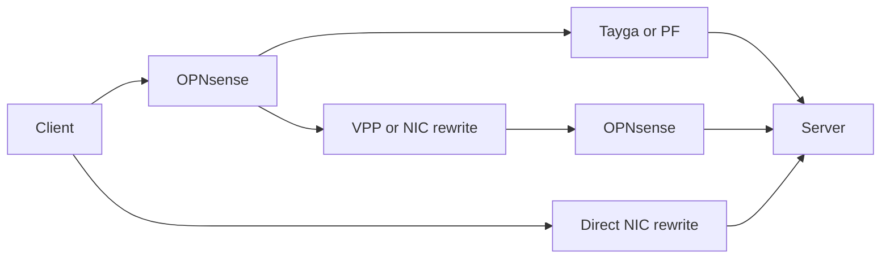

# MWAN packet forwarding performance

MWAN forwards packets in the guest kernel. Routes, policy rules, and nftables
rules do not send packet bytes to the daemon. A host bridge uses host CPU to
transfer packets between router and gateway guests. A NIC can instead switch
packets between hardware virtual functions assigned to separate containers.

CPU usage adds the work across logical CPUs, or hardware threads. Host CPU
includes guest work, traffic generation, and other active host work.

CPU percentage scale:

| Fully busy logical CPUs | Summed CPU usage |
| --- | ---: |
| 1 | 100% |
| 8 | 800% |

OPNsense [requires disabled hardware offloads in IPS mode](https://docs.opnsense.org/manual/ips.html).
OPNsense [disables several NIC offloads by default](https://docs.opnsense.org/manual/interfaces_settings.html)
and [disables system-wide receive-side scaling by default](https://docs.opnsense.org/troubleshooting/performance.html).

## Attachment paths

The WAN attachment and the router attachment are independent. These diagrams
show PCI passthrough, virtual WAN, and host bridge attachment.

### ISP NIC passed to the gateway

PCI passthrough assigns the physical NIC to the gateway guest. The WAN
attachment does not use a host bridge for packet transfer.

### ISP NIC attached to the host

A virtual WAN attaches the ISP NIC to the host. The host transfers packets
between that NIC and the gateway guest.

### Router and gateway on one host bridge

Separate router and gateway guests use the host bridge for their shared
attachment. PCI passthrough on a WAN NIC does not remove this transfer.

In the architecture example, ISP-1 and ISP-2 use PCI passthrough. ISP-3 uses a
virtual WAN. Every packet between the router and gateway guests uses their
host bridge.

## Measurement on August 16, 2026

The upload measurements compare CPU use for routing and NAT inside the router
and gateway guests with the host CPU used to copy packets between those guests.

Test measurements:

| Measurement | Result |
| --- | ---: |
| Download | 693 Mbit/s |
| Upload | 1782 Mbit/s |
| Recorded host CPU capacity | 12 cores |
| Copy threads' share of combined guest work at upload peak | About 15% |

The CPU breakdown distinguishes guest processing from host packet copying.

Host CPU use:

| CPU usage, summed across logical CPUs | Before test | Upload peak |
| --- | ---: | ---: |
| Router guest copy thread | 1.00% | 59.00% |
| Gateway guest copy thread | 1.00% | 52.00% |
| Both copy threads | 2.00% | 111.00% |
| Router guest forwarding | Not measured | 454.00% |
| Gateway guest forwarding | Not measured | 201.00% |
| Both guests forwarding | Not measured | 655.00% |
| Forwarding and copy threads | Not measured | 766.00% |

## Vault and PowerEdge translation performance

The comparison evaluates PowerEdge translation options against Vault's
installed OPNsense router under the recorded workload and CPU allocations.

Test conditions:

| Test condition | Value |
| --- | --- |
| Host CPU capacity | Vault: 12 logical CPUs, maximum 1200%; PowerEdge: 16 logical CPUs, maximum 1600% |
| OPNsense VM allocation | Vault: 4 vCPUs, maximum 400%; PowerEdge: 8 vCPUs, maximum 800% |
| Traffic | 8 clients; TCP: 4 streams each, uncapped; UDP: 1 stream each, 1400-byte payload, 5 Gbit/s per direction |
| Measured duration | 20 seconds; TCP excludes 3 seconds of warmup |
| Network | Vault uses its physical LAN; PowerEdge uses the NIC internal switch. |
| Traffic generator | iperf3 3.18 with synchronized UDP starts |
| Generator placement | PowerEdge runs both endpoints. Vault uses NAS as its client and runs the server locally. |
| Recorded PowerEdge WAN and LAN links | 10 Gbit/s full duplex each, from iDRAC NIC inventory. |
| PowerEdge NIC and drivers | Broadcom BCM57504; OPNsense uses a rebuilt Broadcom driver. The DPDK build includes the [submitted BNXT firmware-command fix](https://patches.dpdk.org/project/dpdk/patch/20261018022929.91865-1-alex@goodkind.io/). |
| PowerEdge software settings | TruFlow enabled; VF MSI-X capacity 16; OPNsense uses 8 queues and VPP uses 4. |
| NIC test settings | TruFlow enabled; VF MSI-X capacity 16; OPNsense uses 8 queues. |
| Hardware scope | Fixed address mappings, with a separate source address per client; PF NAT66 combines sources. The tested driver rejects NAT64. |
| VPP driver mode | VPP performs CPU translation and uses [app-id=255](https://github.com/DPDK/dpdk/blob/v26.03/drivers/net/bnxt/bnxt.h#L895-L896) to disable TruFlow for its interfaces. |
| Tayga UDP timing | Recorded interval: 46.57 s. Required interval: 18 to 22 s. |

Efficiency divides combined received Mbps by summed routing/translation CPU
percentage points, using the rounded measurements in these comparison tables.

TCP tests compare transfer capacity without a sender rate limit.
UDP tests compare packet delivery under the same requested load.

### NAT64

TCP throughput and CPU use:

| Host | Translation | Software | Received Gbit/s, forward / reverse | Routing / translation CPU | Total host CPU | Mbps per routing / translation CPU percentage point |
| --- | --- | --- | --- | --- | --- | --- |
| Vault | NAT64 | Tayga | 0.93 / 0.35 | 442.80% | 908.28% | 2.89 |
| PowerEdge | NAT64 | Tayga | 1.28 / 1.48 | 794.08% | 1014.24% | 3.48 |
| PowerEdge | NAT64 | OPNsense + VPP | 4.91 / 5.25 | 1134.40% | 1379.84% | 8.96 |

UDP throughput, loss, and CPU use:

| Host | Translation | Software | Sent Gbit/s | Received Gbit/s | Packets not received | Routing / translation CPU | Total host CPU | Mbps per routing / translation CPU percentage point |
| --- | --- | --- | --- | --- | --- | --- | --- | --- |
| Vault | NAT64 | Tayga | Test failed | Test failed | Test failed | Not measured | Not measured | Not measured |
| PowerEdge | NAT64 | Tayga | Invalid timing | Invalid timing | Invalid timing | Not measured | Not measured | Not measured |
| PowerEdge | NAT64 | OPNsense + VPP | 5.00 / 5.00 | 1.03 / 1.16 | 79.35% / 76.79% | 1125.44% | 1576.64% | 1.95 |

### NAT66

TCP throughput and CPU use:

| Host | Translation | Software | Received Gbit/s, forward / reverse | Routing / translation CPU | Total host CPU | Mbps per routing / translation CPU percentage point |
| --- | --- | --- | --- | --- | --- | --- |
| Vault | NAT66 | PF | 2.35 / 0.28 | 347.64% | 855.96% | 7.57 |
| PowerEdge | NAT66 | PF | 10.22 / 11.29 | 777.92% | 1163.84% | 27.65 |
| PowerEdge | NAT66 | OPNsense + VPP | 5.10 / 5.64 | 1150.40% | 1385.76% | 9.34 |
| PowerEdge | Fixed NAT66 | OPNsense + TruFlow | 6.27 / 5.92 | 776.64% | 1044.48% | 15.70 |
| PowerEdge | Fixed NAT66 | TruFlow without OPNsense | 31.81 / 36.97 | 0.1040% | 1540.00% | Controller only |

UDP throughput, loss, and CPU use:

| Host | Translation | Software | Sent Gbit/s | Received Gbit/s | Packets not received | Routing / translation CPU | Total host CPU | Mbps per routing / translation CPU percentage point |
| --- | --- | --- | --- | --- | --- | --- | --- | --- |
| Vault | NAT66 | PF | 2.53 / 5.00 | 1.72 / 1.06 | 31.15% / 78.78% | 367.68% | 1098.84% | 7.56 |
| PowerEdge | NAT66 | PF | 5.00 / 5.00 | 4.58 / 3.21 | 8.39% / 35.86% | 768.96% | 1475.52% | 10.13 |
| PowerEdge | NAT66 | OPNsense + VPP | 5.00 / 5.00 | 2.88 / 1.11 | 42.11% / 77.84% | 1093.76% | 1577.44% | 3.65 |
| PowerEdge | Fixed NAT66 | OPNsense + TruFlow | 5.00 / 5.00 | 3.70 / 3.60 | 25.96% / 27.96% | 779.20% | 1464.00% | 9.37 |
| PowerEdge | Fixed NAT66 | TruFlow without OPNsense | 5.00 / 5.00 | 4.99 / 4.99 | 0.13% / 0.16% | 0.0816% | 897.60% | Controller only |

### NPT

TCP throughput and CPU use:

| Host | Translation | Software | Received Gbit/s, forward / reverse | Routing / translation CPU | Total host CPU | Mbps per routing / translation CPU percentage point |
| --- | --- | --- | --- | --- | --- | --- |
| Vault | NPT | PF BINAT | 2.33 / 0.22 | 347.40% | 864.24% | 7.34 |
| PowerEdge | NPT | PF BINAT | 10.10 / 10.86 | 774.56% | 1139.20% | 27.06 |
| PowerEdge | NPT, RFC 6296 | OPNsense + VPP | 5.32 / 5.37 | 1160.00% | 1390.08% | 9.22 |
| PowerEdge | Fixed NPT | OPNsense + TruFlow | 6.44 / 5.74 | 774.24% | 1041.28% | 15.73 |

UDP throughput, loss, and CPU use:

| Host | Translation | Software | Sent Gbit/s | Received Gbit/s | Packets not received | Routing / translation CPU | Total host CPU | Mbps per routing / translation CPU percentage point |
| --- | --- | --- | --- | --- | --- | --- | --- | --- |
| Vault | NPT | PF BINAT | 2.35 / 5.00 | 1.27 / 1.17 | 45.50% / 76.66% | 335.52% | 1155.84% | 7.27 |
| PowerEdge | NPT | PF BINAT | 5.00 / 5.00 | 4.60 / 4.69 | 8.05% / 6.29% | 764.80% | 1491.20% | 12.15 |
| PowerEdge | NPT, RFC 6296 | OPNsense + VPP | 5.00 / 5.00 | 2.57 / 2.75 | 48.60% / 45.04% | 1049.12% | 1574.72% | 5.07 |
| PowerEdge | Fixed NPT | OPNsense + TruFlow | 5.00 / 5.00 | 2.95 / 3.24 | 40.91% / 35.17% | 771.52% | 1427.36% | 8.02 |

Rate pairs list simultaneous traffic from client to server and from server to
client, in that order. Routing/translation CPU combines OPNsense with its
external translator or NIC rule controller, except that the direct NIC test
counts only its controller.

PF BINAT replaces the prefix and updates checksums, while VPP applies the
different [RFC 6296 address calculation](https://www.rfc-editor.org/rfc/rfc6296.html).

## PowerEdge whole-prefix translation

These tests compare complete prefix translation with the NIC internal switch
and peer VFs generating traffic. Single-prefix tests use VF1 and VF2. Dual-prefix
tests use separate external prefixes on VF1 and VF2 and one ULA prefix on VF3.

The workload matches the earlier TCP and UDP settings. VPP uses the
[local checksum-fold correction](performance-vpp-checksum.patch) and equal-weight
connection hashing. Linux alternates new connections between WANs and preserves
the assignment, while native OPNsense uses equal-weight multi-WAN. TruFlow
steers packets in the hybrid test while VPP performs prefix translation on the CPU.

Bold software identifies the [NPT translator MWAN uses today](../gateway/internal/ifmgr/modules/npt/bpf/npt.c),
not an exact reproduction of its WAN-selection configuration. Rows sort by
combined received Mbps per summed total-host CPU percentage point within each prefix
policy. Bold rates and efficiency identify the best valid result in each policy.
Kernel means the test did not measure translation CPU separately. Host CPU
includes traffic generation, and VPP CPU includes polling and packet handling.

TCP measures uncapped transfer capacity with simultaneous traffic in both directions.

Single-prefix TCP throughput and CPU use:

| Host | Translation | Software | Received Gbit/s, forward / reverse | Routing / translation CPU | Total host CPU | Mbps per total host CPU percentage point |
| --- | --- | --- | --- | --- | --- | --- |
| PowerEdge | Single prefix | VPP + TruFlow steering | **20.91 / 20.70** | 386.04% | 1221.79% | **34.05** |
| PowerEdge | Single prefix | VPP | 20.36 / 20.98 | 386.16% | 1224.95% | 33.75 |
| PowerEdge | Single prefix | **MWAN eBPF** | 19.71 / 18.86 | Kernel | 1413.34% | 27.29 |
| PowerEdge | Single prefix | nftables | 19.57 / 18.89 | Kernel | 1424.13% | 27.00 |
| PowerEdge | Single prefix | PF BINAT | 13.19 / 12.53 | 779.36% | 1189.90% | 21.61 |

Dual-prefix load-balancing TCP throughput and CPU use:

| Host | Translation | Software | Received Gbit/s, forward / reverse | Routing / translation CPU | Total host CPU | Mbps per total host CPU percentage point |
| --- | --- | --- | --- | --- | --- | --- |
| PowerEdge | Dual, connection | VPP + TruFlow steering | 20.56 / 20.50 | 356.76% | 1355.04% | **30.30** |
| PowerEdge | Dual, connection | VPP | **20.66 / 20.66** | 354.32% | 1378.53% | 29.97 |
| PowerEdge | Dual, connection | MWAN eBPF + nftables software flowtable | 17.56 / 18.23 | Kernel | 1292.24% | 27.69 |
| PowerEdge | Dual, connection | **MWAN eBPF** | 18.09 / 17.95 | Kernel | 1350.39% | 26.69 |
| PowerEdge | Dual, connection | nftables | 17.81 / 18.13 | Kernel | 1352.30% | 26.58 |
| PowerEdge | Dual, connection | PF BINAT | 9.30 / 13.91 | 786.05% | 1200.86% | 19.33 |
| PowerEdge | Dual, connection | OPNsense multi-WAN | 9.68 / 12.14 | 787.38% | 1177.76% | 18.53 |

UDP compares packet delivery at the requested load rather than maximum capacity.
The eBPF packet-selection sender failed its requested forward load. Packet
selection results do not rank as working alternatives for TCP connections.

Single-prefix UDP throughput, loss, and CPU use:

| Host | Translation | Software | Sent Gbit/s | Received Gbit/s, forward / reverse | Packets not received | Routing / translation CPU | Total host CPU | Mbps per total host CPU percentage point |
| --- | --- | --- | --- | --- | --- | --- | --- | --- |
| PowerEdge | Single prefix | VPP | 5.00 / 5.00 | **4.99 / 4.97** | 0.16% / 0.54% | 385.26% | 1201.02% | **8.30** |
| PowerEdge | Single prefix | VPP + TruFlow steering | 5.00 / 5.00 | 4.98 / 4.99 | 0.43% / 0.29% | 381.80% | 1202.43% | 8.29 |
| PowerEdge | Single prefix | **MWAN eBPF** | 4.99 / 5.00 | 4.96 / 4.97 | 0.73% / 0.56% | Kernel | 1286.85% | 7.72 |
| PowerEdge | Single prefix | nftables | 5.00 / 5.00 | 4.96 / 4.93 | 0.87% / 1.32% | Kernel | 1303.06% | 7.59 |
| PowerEdge | Single prefix | PF BINAT | 5.00 / 5.00 | 4.70 / 4.77 | 5.98% / 4.63% | 687.03% | 1444.90% | 6.55 |

Dual-prefix load-balancing UDP throughput, loss, and CPU use:

| Host | Translation | Software | Sent Gbit/s | Received Gbit/s, forward / reverse | Packets not received | Routing / translation CPU | Total host CPU | Mbps per total host CPU percentage point |
| --- | --- | --- | --- | --- | --- | --- | --- | --- |
| PowerEdge | Dual, connection | VPP | 5.00 / 5.00 | 4.99 / 4.93 | 0.24% / 1.33% | 380.11% | 1268.30% | **7.82** |
| PowerEdge | Dual, connection | VPP + TruFlow steering | 5.00 / 5.00 | 4.99 / 4.98 | 0.17% / 0.46% | 380.07% | 1310.33% | 7.61 |
| PowerEdge | Dual, connection | nftables | 5.00 / 5.00 | 4.84 / 4.92 | 3.24% / 1.66% | Kernel | 1310.61% | 7.44 |
| PowerEdge | Dual, connection | **MWAN eBPF** | 5.00 / 5.00 | 4.95 / 4.97 | 0.92% / 0.66% | Kernel | 1345.71% | 7.37 |
| PowerEdge | Dual, connection | MWAN eBPF + nftables software flowtable | 5.00 / 5.00 | **4.98 / 4.99** | 0.32% / 0.22% | Kernel | 1352.90% | 7.37 |
| PowerEdge | Dual, connection | PF BINAT | 5.00 / 5.00 | 4.61 / 4.80 | 7.78% / 3.97% | 726.23% | 1460.08% | 6.45 |
| PowerEdge | Dual, connection | OPNsense multi-WAN | 5.00 / 5.00 | 4.58 / 4.58 | 8.45% / 8.32% | 701.95% | 1435.24% | 6.38 |
| PowerEdge | Dual, packet | nftables | 4.98 / 5.00 | 2.44 / 4.93 | 51.07% / 1.43% | Kernel | 1250.78% | 5.89 |
| PowerEdge | Dual, packet | **MWAN eBPF** | 0.000098 / 5.00 | 0.000049 / 5.00 | 50.29% / 0.05% | Kernel | 546.42% | Forward load failed |

Native command output and packet observations explain the unavailable policies.

Whole-prefix policy attempts:

| Configuration | Observed result |
| --- | --- |
| TruFlow only, single prefix | Source and destination prefix-action validation failed with `Truflow parser does not support act 50` before rule creation. |
| TruFlow only, dual prefixes | Separate source and destination prefix-action attempts produced the same driver rejection. |
| VPP, dual per packet | `set ip6 flow-hash` rejected `per-packet` with `unknown input`. |
| VPP + TruFlow, dual per packet | The separate hybrid attempt produced the same native command rejection. |
| MWAN eBPF, per-packet TCP | The capture showed different external source prefixes for SYN and ACK, and the receiver reset the connection. |
| nftables, per-packet TCP | The separate capture also showed a source-prefix change during connection setup and a receiver reset. |
| PF BINAT, dual per packet | PF accepted the `no state` filter rule but created a UDP translation state with `MULTIPLE:SINGLE`, and the echo timed out. |
| eBPF + software flowtable, dual per packet | The flowtable retained one WAN after connection setup. Disabling only the flowtable restored equal packet alternation. |

### Dual-prefix CPU profiling

The profiled reruns use the same workload with VPP + TruFlow steering and
MWAN's native [Go controller](https://github.com/agoodkind/mwan/blob/b8056e16541c39a484d08113f0ab6fc81ebffff7/cmd/mwan/ifmgr.go).
MWAN uses source-and-destination connection hashing and connected ULA return
routes in both WAN policy tables.

This table reports CPU use as a share of total host capacity, while earlier
tables sum logical CPU usage. MWAN's kernel samples include traffic generation,
while its program and service counters isolate NPT and controller execution.
VPP's routing samples combine lookup and WAN hashing.

Profiled throughput and selected CPU costs:

| Measurement | VPP + TruFlow TCP | MWAN TCP | VPP + TruFlow UDP | MWAN UDP |
| --- | ---: | ---: | ---: | ---: |
| Received Gbit/s, forward / reverse | 20.65 / 20.49 | 18.32 / 17.71 | 4.96 / 4.94 | 4.64 / 4.85 |
| Packets not received | Not applicable | Not applicable | 0.81% / 1.19% | 7.18% / 2.95% |
| Total host CPU | 85.96% | 87.01% | 80.07% | 82.78% |
| Idle host CPU | 29.68% | 6.17% | 29.42% | 6.28% |
| VPP process CPU | 22.60% | Not applicable | 23.50% | Not applicable |
| Receive and polling CPU | 4.17% | Not isolated | 7.33% | Not isolated |
| Transmit CPU | 6.34% | Not isolated | 1.23% | Not isolated |
| Routing and WAN selection CPU | 1.59% | Not isolated | 0.49% | Not isolated |
| NPT execution CPU | 0.87% | 1.55% | 0.33% | 2.51% |
| VPP worker scheduling and packet buffers CPU | 2.38% | Not applicable | 9.13% | Not applicable |
| TruFlow controller or Go daemon CPU | 0.0043% | 0.0125% | 0.0015% | 0.0045% |
| Mbps per total host CPU percentage point | 478.59 | 414.08 | 123.64 | 114.65 |

## Remaining investigation

MWAN-527 tracks the forwarding comparison with a software bridge.
