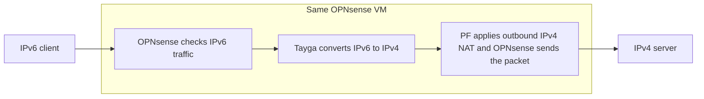
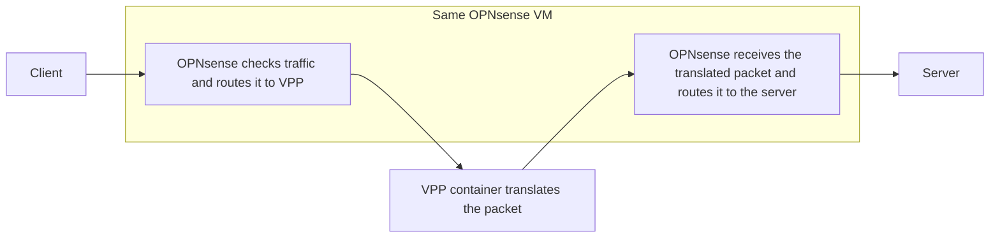
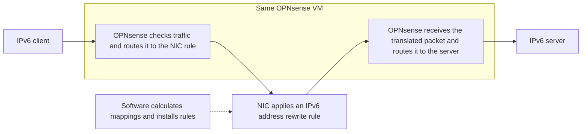

# MWAN packet forwarding performance

## Translation results

Vault uses its installed OPNsense router and physical LAN. PowerEdge uses the network card’s internal switch and compares translation inside an OPNsense test VM with translation in a separate Vector Packet Processing (VPP) container that returns packets to OPNsense.

Forward means client to server. Reverse means server to client after the client establishes the connection. CPU percentages use every logical CPU on the router host. OPNsense VM CPU includes guest processors and the other QEMU threads that run the VM; VPP CPU includes its container.

### TCP

The senders have an unlimited rate and send in both directions simultaneously.

| Condition | Value |
| --- | --- |
| Clients | 8 |
| Streams per client per direction | 4 |

| Translation | Setup | Forward, Gbit/s | Reverse, Gbit/s | OPNsense VM CPU | VPP CPU |
| --- | --- | --- | --- | --- | --- |
| NAT64 | Vault / Tayga | 0.93 | 0.35 | 36.90% | Not used |
| NAT64 | PowerEdge / Tayga | 1.41 | 1.51 | 49.75% | Not used |
| NAT64 | PowerEdge / VPP | 5.24 | 4.90 | 45.41% | 20.38% |
| NAT66 | Vault / PF | 2.35 | 0.28 | 28.97% | Not used |
| NAT66 | PowerEdge / PF | 10.65 | 10.48 | 49.12% | Not used |
| NAT66 | PowerEdge / VPP | 5.49 | 5.41 | 47.31% | 20.48% |
| NPTv6 (PF BINAT) | Vault / PF | 2.33 | 0.22 | 28.95% | Not used |
| NPTv6 (PF BINAT) | PowerEdge / PF | 10.53 | 12.44 | 48.61% | Not used |
| RFC 6296 NPT66 | PowerEdge / VPP | 6.18 | 4.95 | 47.32% | 20.46% |

### UDP

Failed tests lack complete reports, configuration verification, or valid measurement intervals. They do not establish a throughput value. Each valid row uses the same requested load, and each paired value lists forward first and reverse second. UDP delivery loss measures the share of sent packets that the receiver did not record, including missing final packets.

| Condition | Value |
| --- | --- |
| Payload | 1400 bytes |
| Requested rate | 5 Gbit/s in each direction simultaneously |

| Translation | Setup | Sent, Gbit/s | Received, Gbit/s | Delivery loss | OPNsense VM CPU | VPP CPU |
| --- | --- | --- | --- | --- | --- | --- |
| NAT64 | Vault / Tayga | Test failed | Test failed | Test failed | Not measured | Not measured |
| NAT64 | PowerEdge / Tayga | 5.00 / 5.00 | 1.53 / 1.59 | 68.91% / 68.24% | 49.08% | Not used |
| NAT64 | PowerEdge / VPP | 5.00 / 5.00 | 0.75 / 0.96 | 85.08% / 80.72% | 48.09% | 19.81% |
| NAT66 | Vault / PF | 2.53 / 5.00 | 1.72 / 1.06 | 31.15% / 78.78% | 30.64% | Not used |
| NAT66 | PowerEdge / PF | 5.00 / 5.00 | 4.50 / 2.59 | 9.66% / 48.17% | 46.11% | Not used |
| NAT66 | PowerEdge / VPP | 5.00 / 5.00 | 2.81 / 1.52 | 43.64% / 69.56% | 41.37% | 18.62% |
| NPTv6 (PF BINAT) | Vault / PF | 2.35 / 5.00 | 1.27 / 1.17 | 45.50% / 76.66% | 27.96% | Not used |
| NPTv6 (PF BINAT) | PowerEdge / PF | 5.00 / 5.00 | 4.58 / 4.60 | 8.37% / 7.91% | 47.88% | Not used |
| RFC 6296 NPT66 | PowerEdge / VPP | 5.00 / 5.00 | 2.49 / 2.62 | 50.22% / 47.53% | 45.14% | 18.49% |

### Meaning for the router choice

| Workload | Supported choice | What the measurements show |
| --- | --- | --- |
| Several NAT64 TCP transfers at once | PowerEdge OPNsense with VPP | VPP delivered more TCP traffic than Tayga and used CPU while idle. |
| A single forward NAT64 TCP transfer | Similar measured rates on PowerEdge | Tayga and VPP delivered similar rates in this test. Tayga avoids the VPP polling cost. |
| NAT64 UDP at the main table's payload and load | Tayga inside PowerEdge OPNsense | Tayga delivered more UDP traffic with lower delivery loss than the external VPP path. |
| NAT66 | PF inside PowerEdge OPNsense | Direct PF delivered more TCP and UDP traffic than the external VPP path. |
| IPv6 prefix translation | Select the required address mapping | PF BINAT delivered more TCP and UDP traffic. VPP applies the different RFC 6296 address calculation. |
| Translation inside the NIC | The Linux switchdev test used a deprecated firmware command. | DPDK TruFlow uses a different command; the Linux failure does not establish the card's translation limit. |

Single connections, separate directions, idle CPU, and every UDP load

### Single TCP connections and separate directions

| Translation | Setup | Clients × streams | Direction | Received, Gbit/s | OPNsense VM CPU | VPP CPU | Host CPU | Retransmissions |
| --- | --- | --- | --- | --- | --- | --- | --- | --- |
| NAT64 | Vault / Tayga | 1 × 1 | forward | 0.93 | 30.30% | Not used | 66.60% | 5263 |
| NAT64 | Vault / Tayga | 1 × 1 | reverse | 0.53 | 16.30% | Not used | 45.99% | 13162 |
| NAT64 | Vault / Tayga | 8 × 4 | forward | 1.31 | 37.70% | Not used | 76.67% | 64204 |
| NAT64 | Vault / Tayga | 8 × 4 | reverse | 0.97 | 36.81% | Not used | 69.12% | 70450 |
| NAT64 | PowerEdge / Tayga | 1 × 1 | forward | 4.41 | 21.74% | Not used | 31.20% | 43745 |
| NAT64 | PowerEdge / Tayga | 1 × 1 | reverse | 1.61 | 15.02% | Not used | 23.19% | 12433 |
| NAT64 | PowerEdge / Tayga | 8 × 4 | forward | 3.05 | 49.84% | Not used | 63.65% | 92963 |
| NAT64 | PowerEdge / Tayga | 8 × 4 | reverse | 2.96 | 49.63% | Not used | 63.27% | 89533 |
| NAT64 | PowerEdge / VPP | 1 × 1 | forward | 4.44 | 33.60% | 20.68% | 63.93% | 448 |
| NAT64 | PowerEdge / VPP | 1 × 1 | reverse | 2.48 | 16.56% | 21.22% | 44.61% | 86 |
| NAT64 | PowerEdge / VPP | 8 × 4 | forward | 8.47 | 44.98% | 20.41% | 80.41% | 49498 |
| NAT64 | PowerEdge / VPP | 8 × 4 | reverse | 7.62 | 42.04% | 20.61% | 72.92% | 51681 |
| NAT66 | Vault / PF | 1 × 1 | forward | 2.30 | 19.79% | Not used | 52.53% | 116 |
| NAT66 | Vault / PF | 1 × 1 | reverse | 0.78 | 10.86% | Not used | 41.60% | 15888 |
| NAT66 | Vault / PF | 8 × 4 | forward | 2.28 | 31.00% | Not used | 74.55% | 7027 |
| NAT66 | Vault / PF | 8 × 4 | reverse | 1.04 | 27.02% | Not used | 59.42% | 79403 |
| NAT66 | PowerEdge / PF | 1 × 1 | forward | 6.89 | 14.89% | Not used | 24.06% | 1959 |
| NAT66 | PowerEdge / PF | 1 × 1 | reverse | 4.95 | 18.81% | Not used | 27.16% | 58 |
| NAT66 | PowerEdge / PF | 8 × 4 | forward | 20.36 | 45.85% | Not used | 67.99% | 54471 |
| NAT66 | PowerEdge / PF | 8 × 4 | reverse | 20.05 | 46.09% | Not used | 67.14% | 56345 |
| NAT66 | PowerEdge / VPP | 1 × 1 | forward | 5.04 | 32.93% | 21.16% | 61.49% | 163 |
| NAT66 | PowerEdge / VPP | 1 × 1 | reverse | 2.89 | 18.27% | 21.23% | 46.61% | 204 |
| NAT66 | PowerEdge / VPP | 8 × 4 | forward | 9.95 | 46.45% | 20.53% | 78.85% | 36759 |
| NAT66 | PowerEdge / VPP | 8 × 4 | reverse | 9.38 | 45.87% | 20.51% | 78.19% | 39459 |
| NPTv6 (PF BINAT) | Vault / PF | 1 × 1 | forward | 2.30 | 19.20% | Not used | 56.37% | 175 |
| NPTv6 (PF BINAT) | Vault / PF | 1 × 1 | reverse | 0.64 | 11.69% | Not used | 42.51% | 16479 |
| NPTv6 (PF BINAT) | Vault / PF | 8 × 4 | forward | 2.29 | 27.46% | Not used | 73.12% | 5200 |
| NPTv6 (PF BINAT) | Vault / PF | 8 × 4 | reverse | 0.95 | 26.13% | Not used | 57.73% | 75776 |
| NPTv6 (PF BINAT) | PowerEdge / PF | 1 × 1 | forward | 6.12 | 22.51% | Not used | 31.81% | 436 |
| NPTv6 (PF BINAT) | PowerEdge / PF | 1 × 1 | reverse | 7.10 | 21.47% | Not used | 31.50% | 479 |
| NPTv6 (PF BINAT) | PowerEdge / PF | 8 × 4 | forward | 20.22 | 48.30% | Not used | 68.91% | 43232 |
| NPTv6 (PF BINAT) | PowerEdge / PF | 8 × 4 | reverse | 20.30 | 45.94% | Not used | 66.35% | 49808 |
| RFC 6296 NPT66 | PowerEdge / VPP | 1 × 1 | forward | 4.22 | 16.92% | 21.17% | 45.04% | 367 |
| RFC 6296 NPT66 | PowerEdge / VPP | 1 × 1 | reverse | 4.53 | 25.54% | 21.18% | 54.12% | 415 |
| RFC 6296 NPT66 | PowerEdge / VPP | 8 × 4 | forward | 11.46 | 46.36% | 20.50% | 80.19% | 42642 |
| RFC 6296 NPT66 | PowerEdge / VPP | 8 × 4 | reverse | 9.85 | 44.69% | 20.46% | 77.25% | 41754 |

### CPU at idle and under simultaneous TCP load

VPP polls its receive queues while idle. The idle baseline precedes each simultaneous TCP run, and workload CPU includes that idle cost. Vault uses NAS as its client; PowerEdge runs its client locally. Total host CPU includes different endpoint work.

| Translation | Setup | Idle VM CPU | Idle VPP CPU | Idle host CPU | Workload host CPU | TCP retransmissions, forward / reverse |
| --- | --- | --- | --- | --- | --- | --- |
| NAT64 | Vault / Tayga | 1.57% | Not used | 31.52% | 75.69% | 49678 / 34523 |
| NAT64 | PowerEdge / Tayga | 0.25% | Not used | 5.96% | 63.35% | 59888 / 60365 |
| NAT64 | PowerEdge / VPP | 0.18% | 21.73% | 26.13% | 80.68% | 37692 / 31227 |
| NAT66 | Vault / PF | 3.33% | Not used | 27.11% | 71.33% | 7258 / 21024 |
| NAT66 | PowerEdge / PF | 0.36% | Not used | 6.53% | 73.94% | 37961 / 39108 |
| NAT66 | PowerEdge / VPP | 0.42% | 21.43% | 26.14% | 81.77% | 36171 / 32805 |
| NPTv6 (PF BINAT) | Vault / PF | 0.87% | Not used | 23.41% | 72.02% | 11494 / 20153 |
| NPTv6 (PF BINAT) | PowerEdge / PF | 0.44% | Not used | 5.78% | 74.38% | 32250 / 34491 |
| RFC 6296 NPT66 | PowerEdge / VPP | 0.42% | 21.60% | 26.28% | 81.95% | 31024 / 33558 |

### Every UDP load

The requested rate applies separately to each direction. Every requested test ran. Report, configuration verification, or timing failures exclude results from the comparison after the bounded retry round.

| Test group | Accepted results | Excluded results |
| --- | ---: | ---: |
| Single TCP | 18 | 0 |
| Parallel TCP | 27 | 0 |
| UDP | 78 | 12 |

#### Larger UDP packets

| Condition | Value |
| --- | --- |
| Payload | 1400 bytes |

| Setup / translation | Requested Gbit/s | Sent Gbit/s, forward / reverse | Received Gbit/s, forward / reverse | Delivery loss, forward / reverse |
| --- | --- | --- | --- | --- |
| Vault / Tayga / NAT64 | 0.25 | 0.25 / 0.25 | 0.25 / 0.25 | 0.66570% / 0.95456% |
| Vault / Tayga / NAT64 | 0.50 | 0.50 / 0.50 | 0.49 / 0.49 | 1.99050% / 2.88899% |
| Vault / Tayga / NAT64 | 1.00 | 1.00 / 1.00 | 0.60 / 0.55 | 39.33164% / 44.53944% |
| Vault / Tayga / NAT64 | 2.50 | Test failed | Test failed | Test failed |
| Vault / Tayga / NAT64 | 5.00 | Test failed | Test failed | Test failed |
| Vault / Tayga / NAT64 | 10.00 | Test failed | Test failed | Test failed |
| PowerEdge / Tayga / NAT64 | 0.25 | 0.25 / 0.25 | 0.25 / 0.25 | 0.02441% / 0.02777% |
| PowerEdge / Tayga / NAT64 | 0.50 | 0.50 / 0.50 | 0.50 / 0.50 | 0.00560% / 0.00851% |
| PowerEdge / Tayga / NAT64 | 1.00 | 1.00 / 1.00 | 0.99 / 1.00 | 0.70222% / 0.40805% |
| PowerEdge / Tayga / NAT64 | 2.50 | 2.50 / 2.50 | 1.40 / 1.51 | 43.79353% / 39.73966% |
| PowerEdge / Tayga / NAT64 | 5.00 | 5.00 / 5.00 | 1.53 / 1.59 | 68.91001% / 68.24266% |
| PowerEdge / Tayga / NAT64 | 10.00 | 10.00 / 10.00 | 1.73 / 0.69 | 81.98900% / 93.12399% |
| PowerEdge / VPP / NAT64 | 0.25 | 0.25 / 0.25 | 0.25 / 0.25 | 0.09609% / 0.21388% |
| PowerEdge / VPP / NAT64 | 0.50 | 0.50 / 0.50 | 0.49 / 0.49 | 1.53861% / 1.28781% |
| PowerEdge / VPP / NAT64 | 1.00 | 1.00 / 1.00 | 0.97 / 0.97 | 2.66696% / 3.20818% |
| PowerEdge / VPP / NAT64 | 2.50 | 2.50 / 2.50 | 0.79 / 0.97 | 68.47219% / 61.23886% |
| PowerEdge / VPP / NAT64 | 5.00 | 5.00 / 5.00 | 0.75 / 0.96 | 85.07770% / 80.71768% |
| PowerEdge / VPP / NAT64 | 10.00 | 10.00 / 10.00 | 0.50 / 0.62 | 94.96632% / 93.74660% |
| Vault / PF / NAT66 | 0.25 | 0.25 / 0.25 | 0.25 / 0.25 | 0.00000% / 0.07167% |
| Vault / PF / NAT66 | 0.50 | 0.50 / 0.50 | 0.50 / 0.50 | 0.02162% / 0.09766% |
| Vault / PF / NAT66 | 1.00 | 1.00 / 1.00 | 0.99 / 0.99 | 0.64706% / 0.93246% |
| Vault / PF / NAT66 | 2.50 | 2.35 / 2.50 | 1.71 / 1.10 | 26.90089% / 56.02515% |
| Vault / PF / NAT66 | 5.00 | 2.53 / 5.00 | 1.72 / 1.06 | 31.14742% / 78.77708% |
| Vault / PF / NAT66 | 10.00 | 2.35 / 8.66 | 1.19 / 0.96 | 48.78218% / 88.89715% |
| PowerEdge / PF / NAT66 | 0.25 | 0.25 / 0.25 | 0.25 / 0.25 | 0.00000% / 0.00067% |
| PowerEdge / PF / NAT66 | 0.50 | 0.50 / 0.50 | 0.50 / 0.50 | 0.00000% / 0.00056% |
| PowerEdge / PF / NAT66 | 1.00 | 1.00 / 1.00 | 1.00 / 1.00 | 0.00000% / 0.00386% |
| PowerEdge / PF / NAT66 | 2.50 | 2.50 / 2.50 | 2.49 / 2.38 | 0.57224% / 4.98424% |
| PowerEdge / PF / NAT66 | 5.00 | 5.00 / 5.00 | 4.50 / 2.59 | 9.65991% / 48.16568% |
| PowerEdge / PF / NAT66 | 10.00 | 10.00 / 10.00 | 4.66 / 2.08 | 53.20935% / 79.22642% |
| PowerEdge / VPP / NAT66 | 0.25 | 0.25 / 0.25 | 0.25 / 0.25 | 0.01008% / 0.00179% |
| PowerEdge / VPP / NAT66 | 0.50 | 0.50 / 0.50 | 0.50 / 0.50 | 0.04032% / 0.22532% |
| PowerEdge / VPP / NAT66 | 1.00 | 1.00 / 1.00 | 1.00 / 0.99 | 0.49094% / 0.74630% |
| PowerEdge / VPP / NAT66 | 2.50 | 2.50 / 2.50 | 2.27 / 2.27 | 9.21754% / 9.27239% |
| PowerEdge / VPP / NAT66 | 5.00 | 5.00 / 5.00 | 2.81 / 1.52 | 43.64326% / 69.55670% |
| PowerEdge / VPP / NAT66 | 10.00 | 10.00 / 10.00 | 0.98 / 0.76 | 90.20045% / 92.44532% |
| Vault / PF / NPTv6 (PF BINAT) | 0.25 | 0.25 / 0.25 | 0.25 / 0.25 | 0.00045% / 1.89755% |
| Vault / PF / NPTv6 (PF BINAT) | 0.50 | 0.50 / 0.50 | 0.50 / 0.47 | 0.00202% / 5.02936% |
| Vault / PF / NPTv6 (PF BINAT) | 1.00 | 1.00 / 1.00 | 1.00 / 0.80 | 0.15943% / 20.01210% |
| Vault / PF / NPTv6 (PF BINAT) | 2.50 | 2.35 / 2.50 | 1.40 / 1.25 | 40.34962% / 49.92931% |
| Vault / PF / NPTv6 (PF BINAT) | 5.00 | 2.35 / 5.00 | 1.27 / 1.17 | 45.49982% / 76.65861% |
| Vault / PF / NPTv6 (PF BINAT) | 10.00 | 2.38 / 8.75 | 0.66 / 1.46 | 72.05140% / 83.33994% |
| PowerEdge / PF / NPTv6 (PF BINAT) | 0.25 | 0.25 / 0.25 | 0.25 / 0.25 | 0.00000% / 0.00202% |
| PowerEdge / PF / NPTv6 (PF BINAT) | 0.50 | 0.50 / 0.50 | 0.50 / 0.50 | 0.00000% / 0.00101% |
| PowerEdge / PF / NPTv6 (PF BINAT) | 1.00 | 1.00 / 1.00 | 1.00 / 1.00 | 0.00017% / 0.00185% |
| PowerEdge / PF / NPTv6 (PF BINAT) | 2.50 | 2.50 / 2.50 | 2.49 / 2.50 | 0.22377% / 0.09154% |
| PowerEdge / PF / NPTv6 (PF BINAT) | 5.00 | 5.00 / 5.00 | 4.58 / 4.60 | 8.36813% / 7.91375% |
| PowerEdge / PF / NPTv6 (PF BINAT) | 10.00 | 10.00 / 9.99 | 3.69 / 3.29 | 63.02496% / 67.07641% |
| PowerEdge / VPP / RFC 6296 NPT66 | 0.25 | 0.25 / 0.25 | 0.25 / 0.25 | 0.00000% / 0.00694% |
| PowerEdge / VPP / RFC 6296 NPT66 | 0.50 | 0.50 / 0.50 | 0.50 / 0.50 | 0.07246% / 0.44012% |
| PowerEdge / VPP / RFC 6296 NPT66 | 1.00 | 1.00 / 1.00 | 1.00 / 0.99 | 0.30676% / 0.72871% |
| PowerEdge / VPP / RFC 6296 NPT66 | 2.50 | 2.50 / 2.50 | 2.31 / 2.33 | 7.66196% / 6.77632% |
| PowerEdge / VPP / RFC 6296 NPT66 | 5.00 | 5.00 / 5.00 | 2.49 / 2.62 | 50.21933% / 47.52837% |
| PowerEdge / VPP / RFC 6296 NPT66 | 10.00 | 9.99 / 9.99 | 1.27 / 1.45 | 87.21765% / 85.53434% |

| Setup / translation | Requested Gbit/s | VM CPU | VPP CPU | Host CPU | Idle VM CPU | Idle VPP CPU | Idle host CPU |
| --- | --- | --- | --- | --- | --- | --- | --- |
| Vault / Tayga / NAT64 | 0.25 | 34.23% | Not used | 77.59% | 0.82% | Not used | 26.91% |
| Vault / Tayga / NAT64 | 0.50 | 36.39% | Not used | 81.65% | 0.94% | Not used | 24.65% |
| Vault / Tayga / NAT64 | 1.00 | 32.65% | Not used | 90.31% | 0.66% | Not used | 30.84% |
| Vault / Tayga / NAT64 | 2.50 | Test failed | Test failed | Test failed | Not measured | Not measured | Not measured |
| Vault / Tayga / NAT64 | 5.00 | Test failed | Test failed | Test failed | Not measured | Not measured | Not measured |
| Vault / Tayga / NAT64 | 10.00 | Test failed | Test failed | Test failed | Not measured | Not measured | Not measured |
| PowerEdge / Tayga / NAT64 | 0.25 | 31.69% | Not used | 43.65% | 0.52% | Not used | 6.58% |
| PowerEdge / Tayga / NAT64 | 0.50 | 46.26% | Not used | 61.31% | 2.46% | Not used | 9.03% |
| PowerEdge / Tayga / NAT64 | 1.00 | 49.54% | Not used | 73.76% | 0.22% | Not used | 6.00% |
| PowerEdge / Tayga / NAT64 | 2.50 | 48.45% | Not used | 83.10% | 0.22% | Not used | 5.81% |
| PowerEdge / Tayga / NAT64 | 5.00 | 49.08% | Not used | 87.03% | 0.43% | Not used | 5.84% |
| PowerEdge / Tayga / NAT64 | 10.00 | 47.17% | Not used | 96.41% | 0.49% | Not used | 6.48% |
| PowerEdge / VPP / NAT64 | 0.25 | 29.39% | 21.06% | 60.76% | 0.37% | 21.58% | 26.34% |
| PowerEdge / VPP / NAT64 | 0.50 | 45.99% | 20.74% | 78.55% | 0.40% | 21.53% | 26.48% |
| PowerEdge / VPP / NAT64 | 1.00 | 49.47% | 19.96% | 86.16% | 0.50% | 21.40% | 26.55% |
| PowerEdge / VPP / NAT64 | 2.50 | 49.26% | 19.95% | 89.92% | 0.45% | 21.46% | 26.47% |
| PowerEdge / VPP / NAT64 | 5.00 | 48.09% | 19.81% | 96.02% | 0.41% | 21.55% | 26.30% |
| PowerEdge / VPP / NAT64 | 10.00 | 37.90% | 19.52% | 99.01% | 0.21% | 21.09% | 32.79% |
| Vault / PF / NAT66 | 0.25 | 25.14% | Not used | 77.69% | 0.94% | Not used | 35.66% |
| Vault / PF / NAT66 | 0.50 | 33.23% | Not used | 75.17% | 0.84% | Not used | 30.98% |
| Vault / PF / NAT66 | 1.00 | 29.92% | Not used | 84.27% | 1.12% | Not used | 34.61% |
| Vault / PF / NAT66 | 2.50 | 33.01% | Not used | 89.33% | 0.81% | Not used | 25.12% |
| Vault / PF / NAT66 | 5.00 | 30.64% | Not used | 91.57% | 0.74% | Not used | 24.49% |
| Vault / PF / NAT66 | 10.00 | 24.97% | Not used | 98.67% | 0.75% | Not used | 35.95% |
| PowerEdge / PF / NAT66 | 0.25 | 17.49% | Not used | 31.94% | 0.52% | Not used | 7.05% |
| PowerEdge / PF / NAT66 | 0.50 | 29.36% | Not used | 44.43% | 0.54% | Not used | 6.77% |
| PowerEdge / PF / NAT66 | 1.00 | 46.10% | Not used | 70.14% | 0.24% | Not used | 6.06% |
| PowerEdge / PF / NAT66 | 2.50 | 47.26% | Not used | 85.62% | 0.21% | Not used | 6.05% |
| PowerEdge / PF / NAT66 | 5.00 | 46.11% | Not used | 89.80% | 0.45% | Not used | 6.17% |
| PowerEdge / PF / NAT66 | 10.00 | 41.56% | Not used | 98.47% | 0.75% | Not used | 6.45% |
| PowerEdge / VPP / NAT66 | 0.25 | 36.51% | 21.11% | 66.34% | 0.80% | 21.71% | 26.66% |
| PowerEdge / VPP / NAT66 | 0.50 | 44.76% | 20.83% | 77.75% | 0.37% | 21.53% | 26.64% |
| PowerEdge / VPP / NAT66 | 1.00 | 49.19% | 19.89% | 87.15% | 0.36% | 21.67% | 26.19% |
| PowerEdge / VPP / NAT66 | 2.50 | 48.40% | 18.86% | 93.15% | 2.01% | 21.45% | 28.59% |
| PowerEdge / VPP / NAT66 | 5.00 | 41.37% | 18.62% | 92.97% | 0.20% | 21.45% | 26.15% |
| PowerEdge / VPP / NAT66 | 10.00 | 37.67% | 19.19% | 99.49% | 0.20% | 21.50% | 26.02% |
| Vault / PF / NPTv6 (PF BINAT) | 0.25 | 26.84% | Not used | 83.82% | 0.81% | Not used | 47.33% |
| Vault / PF / NPTv6 (PF BINAT) | 0.50 | 31.07% | Not used | 89.17% | 0.89% | Not used | 48.53% |
| Vault / PF / NPTv6 (PF BINAT) | 1.00 | 31.51% | Not used | 91.05% | 0.99% | Not used | 54.18% |
| Vault / PF / NPTv6 (PF BINAT) | 2.50 | 27.93% | Not used | 95.19% | 0.85% | Not used | 54.23% |
| Vault / PF / NPTv6 (PF BINAT) | 5.00 | 27.96% | Not used | 96.32% | 2.55% | Not used | 49.31% |
| Vault / PF / NPTv6 (PF BINAT) | 10.00 | 27.26% | Not used | 98.65% | 0.72% | Not used | 22.69% |
| PowerEdge / PF / NPTv6 (PF BINAT) | 0.25 | 19.85% | Not used | 33.72% | 0.29% | Not used | 6.17% |
| PowerEdge / PF / NPTv6 (PF BINAT) | 0.50 | 32.27% | Not used | 46.81% | 2.39% | Not used | 8.29% |
| PowerEdge / PF / NPTv6 (PF BINAT) | 1.00 | 46.13% | Not used | 69.66% | 0.57% | Not used | 6.74% |
| PowerEdge / PF / NPTv6 (PF BINAT) | 2.50 | 48.86% | Not used | 85.94% | 0.22% | Not used | 5.88% |
| PowerEdge / PF / NPTv6 (PF BINAT) | 5.00 | 47.88% | Not used | 93.73% | 0.23% | Not used | 5.67% |
| PowerEdge / PF / NPTv6 (PF BINAT) | 10.00 | 40.89% | Not used | 98.33% | 0.24% | Not used | 5.68% |
| PowerEdge / VPP / RFC 6296 NPT66 | 0.25 | 44.66% | 21.13% | 74.69% | 0.46% | 21.42% | 26.48% |
| PowerEdge / VPP / RFC 6296 NPT66 | 0.50 | 48.13% | 20.74% | 80.76% | 0.22% | 21.34% | 32.52% |
| PowerEdge / VPP / RFC 6296 NPT66 | 1.00 | 49.25% | 19.75% | 87.31% | 0.21% | 21.41% | 28.35% |
| PowerEdge / VPP / RFC 6296 NPT66 | 2.50 | 48.57% | 18.68% | 93.62% | 0.46% | 21.52% | 26.17% |
| PowerEdge / VPP / RFC 6296 NPT66 | 5.00 | 45.14% | 18.49% | 96.84% | 0.42% | 21.38% | 26.26% |
| PowerEdge / VPP / RFC 6296 NPT66 | 10.00 | 36.63% | 18.28% | 99.63% | 0.43% | 21.51% | 26.26% |

#### Smaller UDP packets

| Condition | Value |
| --- | --- |
| Payload | 64 bytes |

| Setup / translation | Requested Gbit/s | Sent Gbit/s, forward / reverse | Received Gbit/s, forward / reverse | Delivery loss, forward / reverse |
| --- | --- | --- | --- | --- |
| Vault / Tayga / NAT64 | 0.01 | 0.01 / 0.01 | 0.01 / 0.01 | 0.41496% / 0.47738% |
| Vault / Tayga / NAT64 | 0.10 | 0.10 / 0.10 | 0.03 / 0.04 | 68.38483% / 63.76762% |
| Vault / Tayga / NAT64 | 1.00 | Test failed | Test failed | Test failed |
| Vault / Tayga / NAT64 | 10.00 | Test failed | Test failed | Test failed |
| PowerEdge / Tayga / NAT64 | 0.01 | 0.01 / 0.01 | 0.01 / 0.01 | 0.00947% / 0.01050% |
| PowerEdge / Tayga / NAT64 | 0.10 | 0.10 / 0.10 | 0.07 / 0.07 | 29.20032% / 25.36709% |
| PowerEdge / Tayga / NAT64 | 1.00 | Test failed | Test failed | Test failed |
| PowerEdge / Tayga / NAT64 | 10.00 | Test failed | Test failed | Test failed |
| PowerEdge / VPP / NAT64 | 0.01 | 0.01 / 0.01 | 0.01 / 0.01 | 0.02714% / 0.01971% |
| PowerEdge / VPP / NAT64 | 0.10 | 0.10 / 0.10 | 0.08 / 0.07 | 22.55579% / 27.14304% |
| PowerEdge / VPP / NAT64 | 1.00 | 0.65 / 0.69 | 0.01 / 0.02 | 98.78710% / 97.58494% |
| PowerEdge / VPP / NAT64 | 10.00 | Test failed | Test failed | Test failed |
| Vault / PF / NAT66 | 0.01 | 0.01 / 0.01 | 0.01 / 0.01 | 0.00000% / 0.00435% |
| Vault / PF / NAT66 | 0.10 | 0.10 / 0.10 | 0.09 / 0.07 | 9.57213% / 33.51087% |
| Vault / PF / NAT66 | 1.00 | 0.87 / 0.46 | 0.02 / 0.02 | 97.90274% / 96.20215% |
| Vault / PF / NAT66 | 10.00 | Test failed | Test failed | Test failed |
| PowerEdge / PF / NAT66 | 0.01 | 0.01 / 0.01 | 0.01 / 0.01 | 0.00000% / 0.00358% |
| PowerEdge / PF / NAT66 | 0.10 | 0.10 / 0.10 | 0.10 / 0.10 | 0.18736% / 1.34942% |
| PowerEdge / PF / NAT66 | 1.00 | 0.73 / 0.74 | 0.16 / 0.06 | 77.68508% / 92.29382% |
| PowerEdge / PF / NAT66 | 10.00 | 0.70 / 0.67 | 0.20 / 0.08 | 72.16947% / 87.52699% |
| PowerEdge / VPP / NAT66 | 0.01 | 0.01 / 0.01 | 0.01 / 0.01 | 0.01434% / 0.01203% |
| PowerEdge / VPP / NAT66 | 0.10 | 0.10 / 0.10 | 0.10 / 0.10 | 0.39396% / 2.62007% |
| PowerEdge / VPP / NAT66 | 1.00 | 0.60 / 0.63 | 0.05 / 0.03 | 90.80556% / 95.14789% |
| PowerEdge / VPP / NAT66 | 10.00 | Test failed | Test failed | Test failed |
| Vault / PF / NPTv6 (PF BINAT) | 0.01 | 0.01 / 0.01 | 0.01 / 0.01 | 0.00000% / 0.00307% |
| Vault / PF / NPTv6 (PF BINAT) | 0.10 | 0.10 / 0.10 | 0.08 / 0.09 | 15.14886% / 12.21920% |
| Vault / PF / NPTv6 (PF BINAT) | 1.00 | Test failed | Test failed | Test failed |
| Vault / PF / NPTv6 (PF BINAT) | 10.00 | Test failed | Test failed | Test failed |
| PowerEdge / PF / NPTv6 (PF BINAT) | 0.01 | 0.01 / 0.01 | 0.01 / 0.01 | 0.00000% / 0.00154% |
| PowerEdge / PF / NPTv6 (PF BINAT) | 0.10 | 0.10 / 0.10 | 0.10 / 0.10 | 0.00005% / 0.00182% |
| PowerEdge / PF / NPTv6 (PF BINAT) | 1.00 | 0.69 / 0.67 | 0.12 / 0.16 | 83.16002% / 76.67164% |
| PowerEdge / PF / NPTv6 (PF BINAT) | 10.00 | 0.63 / 0.72 | 0.12 / 0.15 | 80.67954% / 78.75672% |
| PowerEdge / VPP / RFC 6296 NPT66 | 0.01 | 0.01 / 0.01 | 0.01 / 0.01 | 0.00051% / 0.00154% |
| PowerEdge / VPP / RFC 6296 NPT66 | 0.10 | 0.10 / 0.10 | 0.10 / 0.10 | 0.17013% / 0.09524% |
| PowerEdge / VPP / RFC 6296 NPT66 | 1.00 | 0.57 / 0.65 | 0.06 / 0.06 | 90.02199% / 91.16361% |
| PowerEdge / VPP / RFC 6296 NPT66 | 10.00 | 0.69 / 0.57 | 0.04 / 0.05 | 93.86141% / 91.80778% |

| Setup / translation | Requested Gbit/s | VM CPU | VPP CPU | Host CPU | Idle VM CPU | Idle VPP CPU | Idle host CPU |
| --- | --- | --- | --- | --- | --- | --- | --- |
| Vault / Tayga / NAT64 | 0.01 | 34.04% | Not used | 85.20% | 1.09% | Not used | 58.08% |
| Vault / Tayga / NAT64 | 0.10 | 36.03% | Not used | 87.75% | 1.22% | Not used | 28.56% |
| Vault / Tayga / NAT64 | 1.00 | Test failed | Test failed | Test failed | Not measured | Not measured | Not measured |
| Vault / Tayga / NAT64 | 10.00 | Test failed | Test failed | Test failed | Not measured | Not measured | Not measured |
| PowerEdge / Tayga / NAT64 | 0.01 | 34.94% | Not used | 46.79% | 0.25% | Not used | 6.42% |
| PowerEdge / Tayga / NAT64 | 0.10 | 49.80% | Not used | 80.12% | 0.31% | Not used | 6.49% |
| PowerEdge / Tayga / NAT64 | 1.00 | Test failed | Test failed | Test failed | Not measured | Not measured | Not measured |
| PowerEdge / Tayga / NAT64 | 10.00 | Test failed | Test failed | Test failed | Not measured | Not measured | Not measured |
| PowerEdge / VPP / NAT64 | 0.01 | 21.87% | 21.04% | 52.40% | 0.26% | 21.38% | 25.97% |
| PowerEdge / VPP / NAT64 | 0.10 | 44.87% | 19.79% | 86.20% | 0.24% | 21.46% | 25.88% |
| PowerEdge / VPP / NAT64 | 1.00 | 28.94% | 18.72% | 99.84% | 0.24% | 21.50% | 26.14% |
| PowerEdge / VPP / NAT64 | 10.00 | Test failed | Test failed | Test failed | Not measured | Not measured | Not measured |
| Vault / PF / NAT66 | 0.01 | 26.42% | Not used | 61.45% | 3.95% | Not used | 29.41% |
| Vault / PF / NAT66 | 0.10 | 36.80% | Not used | 87.77% | 0.79% | Not used | 34.48% |
| Vault / PF / NAT66 | 1.00 | 28.11% | Not used | 99.35% | 3.54% | Not used | 29.63% |
| Vault / PF / NAT66 | 10.00 | Test failed | Test failed | Test failed | Not measured | Not measured | Not measured |
| PowerEdge / PF / NAT66 | 0.01 | 15.20% | Not used | 29.25% | 0.45% | Not used | 5.87% |
| PowerEdge / PF / NAT66 | 0.10 | 47.60% | Not used | 80.62% | 0.26% | Not used | 6.31% |
| PowerEdge / PF / NAT66 | 1.00 | 34.30% | Not used | 99.79% | 0.51% | Not used | 7.07% |
| PowerEdge / PF / NAT66 | 10.00 | 34.88% | Not used | 99.85% | 0.20% | Not used | 5.81% |
| PowerEdge / VPP / NAT66 | 0.01 | 34.42% | 21.11% | 64.68% | 1.98% | 21.52% | 27.86% |
| PowerEdge / VPP / NAT66 | 0.10 | 48.76% | 19.32% | 91.31% | 0.26% | 21.39% | 26.16% |
| PowerEdge / VPP / NAT66 | 1.00 | 31.89% | 17.53% | 99.87% | 0.43% | 21.42% | 26.38% |
| PowerEdge / VPP / NAT66 | 10.00 | Test failed | Test failed | Test failed | Not measured | Not measured | Not measured |
| Vault / PF / NPTv6 (PF BINAT) | 0.01 | 21.13% | Not used | 80.53% | 0.89% | Not used | 46.50% |
| Vault / PF / NPTv6 (PF BINAT) | 0.10 | 30.59% | Not used | 92.75% | 1.22% | Not used | 55.68% |
| Vault / PF / NPTv6 (PF BINAT) | 1.00 | Test failed | Test failed | Test failed | Not measured | Not measured | Not measured |
| Vault / PF / NPTv6 (PF BINAT) | 10.00 | Test failed | Test failed | Test failed | Not measured | Not measured | Not measured |
| PowerEdge / PF / NPTv6 (PF BINAT) | 0.01 | 13.77% | Not used | 27.66% | 0.53% | Not used | 6.40% |
| PowerEdge / PF / NPTv6 (PF BINAT) | 0.10 | 46.30% | Not used | 79.67% | 0.50% | Not used | 6.93% |
| PowerEdge / PF / NPTv6 (PF BINAT) | 1.00 | 37.05% | Not used | 99.85% | 0.25% | Not used | 6.28% |
| PowerEdge / PF / NPTv6 (PF BINAT) | 10.00 | 36.21% | Not used | 99.84% | 0.24% | Not used | 5.97% |
| PowerEdge / VPP / RFC 6296 NPT66 | 0.01 | 40.02% | 21.08% | 69.32% | 1.95% | 21.53% | 27.93% |
| PowerEdge / VPP / RFC 6296 NPT66 | 0.10 | 49.29% | 19.05% | 91.83% | 0.23% | 21.43% | 26.87% |
| PowerEdge / VPP / RFC 6296 NPT66 | 1.00 | 32.76% | 17.44% | 99.91% | 0.47% | 21.46% | 26.46% |
| PowerEdge / VPP / RFC 6296 NPT66 | 10.00 | 32.29% | 17.06% | 99.90% | 0.41% | 21.45% | 26.51% |

Test conditions and translation paths

## Test conditions

| Condition | Vault | PowerEdge |
| --- | --- | --- |
| Processor | Intel Core i7-1255U | Intel Xeon Silver 4309Y |
| Host logical CPUs | 12 | 16 |
| OPNsense guest vCPUs | 4 | 8 |
| OPNsense guest memory | 8 GiB | 8 GiB |
| OPNsense release | 26.7.4_1 | 26.7.4_1 |
| Client | NAS on the physical LAN | Linux network namespace on PowerEdge |
| Client attachment | Intel 82599 NIC, switch, and Intel VF assigned to OPNsense | Broadcom BCM57504 VF and the NIC's internal switch |
| Server attachment | Linux network namespace on the virtual WAN bridge | Linux network namespace on a separate Broadcom VF |
| OPNsense checksum and TCP segmentation offloads | Disabled on the inspected LAN and WAN interfaces | Enabled |
| Receive-side scaling | Enabled | Enabled |
| Packet MTU | 1500 bytes | 1500 bytes |
| Parallel TCP clients | 8 | 8 |
| TCP streams per client per direction | 4 | 4 |
| UDP clients and streams | 8 clients, 1 stream each per direction | 8 clients, 1 stream each per direction |
| UDP payload sizes | 1400 and 64 bytes | 1400 and 64 bytes |
| Requested measurement duration | 20 seconds | 20 seconds |
| Accepted native and shared CPU intervals | 18 through 22 seconds | 18 through 22 seconds |
| TCP warmup | 3 seconds | 3 seconds |
| UDP omitted warmup | 0 seconds | 0 seconds |
| UDP startup | Every server completes connection setup before the shared release. | Every server completes connection setup before the shared release. |
| Traffic generator | Native iperf3 3.18 clients; server build with a shared start barrier for UDP | Native iperf3 3.18 clients; the identical server build for UDP |
| Idle CPU baseline | 5 seconds before each test | 5 seconds before each test |
| CPU sample interval | 0.5 seconds | 0.5 seconds |
| OPNsense CPU accounting | Complete VM cgroup, including QEMU work | Complete VM cgroup, including QEMU work |
| VPP CPU accounting | Not used | Complete VPP container cgroup |
| Total host CPU accounting | Includes the router, server, and other host work | Includes the router, VPP when active, both endpoints, and other host work |
| Configured network rate limits | VM and VF settings do not configure a rate limit. | The lab does not configure a rate limit. |
| External Internet | The test server connects to the WAN bridge; the tests do not use an ISP. | The tests use the NIC's internal switch; they do not use an ISP. |
| Repetition | One accepted run per workload | One accepted run per workload |

UDP includes its complete traffic interval. The shared start barrier completes connection setup before sending begins. CPU accounting starts after the verified release and uses complete samples inside the common client interval.

The Vault smoke counter interval includes setup, test traffic, and ordinary NAS traffic. NAS recorded received Ethernet pause frames during that interval. The counter does not identify the requesting device or isolate its effect on the sent rate. The result tables report actual sent traffic whenever a sender falls below its requested rate.

### PowerEdge driver and VPP configuration

| Condition | Recorded setup |
| --- | --- |
| OPNsense driver | The custom `if_bnxt` module from the routed comparison |
| Large receive offload | Off |
| Regular receive descriptors | 1024 per queue set, confirmed by boot output |
| Requested completion/data/aggregation descriptors | `8192,1024,1024`; the requested completion and aggregation counts do not prove their active allocation. |
| VPP software and compilers | Official VPP `26.06-release` core, compiled with Clang/LLVM `18.1.3`; custom DPDK plugin and DPDK `26.03`, compiled with GCC `13.2.0` |
| VPP driver correction | The packaged plugin submitted an empty firmware command header. The custom driver copies each command word with `memcpy` before writing it to the device register. |
| VPP queues | 4 receive queues and 4 transmit queues per VF, with 1024 descriptors per queue |
| VPP configured offloads | IPv4, TCP, and UDP receive checksums; transmit checksums and TCP segmentation; receive-side scaling for IPv4 and IPv6 |
| VPP observed offloads | TCP captures of scalar NAT64 and AVX2 vector NAT66 and NPT66 confirm receive transport checksum validation and receive-side scaling hashes. Their transmitted packets do not request transmit checksum or TCP segmentation offload. The comparison does not include a packet trace for vector NAT64. |
| Management | SSH and file transfers use IPv6. |
| VPP packet processing | AVX2 vector receive, scalar transmit, and CPU address translation |

## Address translation comparison

PowerEdge uses isolated guests on spare Broadcom virtual functions. Vault
uses its installed router and temporary test addresses. Receiver captures
verify translated addresses and replies.

| Translation | What the translator changes | What the comparison measures |
| --- | --- | --- |
| NAT64 | The translator converts IPv6 packets to IPv4 packets and converts replies back. | An IPv6 client communicates with an IPv4 server. |
| Stateful NAT66 | The translator changes IPv6 addresses and may change ports. It remembers each connection to translate replies. | An IPv6 client communicates with an IPv6 server through an address mapping. |
| NPT66 under RFC 6296 | The translator changes the network prefix, the beginning of an IPv6 address that identifies its network. It also adjusts the device part of the address to preserve the checksum, a value that detects packet errors. | An IPv6 client communicates with an IPv6 server through a reversible prefix mapping. |
| OPNsense NPTv6 through PF BINAT | PF replaces the network prefix, keeps the device part of the address, and updates TCP or UDP checksums. | The OPNsense prefix-translation case uses a different address calculation from RFC 6296. |

### Translation inside OPNsense

[Tayga in OPNsense](https://docs.opnsense.org/manual/how-tos/tayga.html)
provides NAT64. OPNsense uses its PF firewall for NAT66 and NPT66, as its
[NAT documentation](https://docs.opnsense.org/manual/nat.html) specifies.
Tayga supplies only the IPv6-to-IPv4 comparison. The OPNsense
[NPTv6 rule generator](https://github.com/opnsense/core/blob/26.7.4/src/opnsense/mvc/app/library/OPNsense/Firewall/NptRule.php#L34-L42)
emits PF BINAT rules. The PF kernel replaces the prefix and updates
transport checksums; VPP uses RFC 6296 address correction.

The internal NAT64 path uses Tayga to convert the packet and PF to apply
outbound IPv4 NAT.

### Translation in a VPP container

Tayga, Jool, and Vector Packet Processing (VPP) use the PowerEdge processor
to translate packets. VPP processes packets in groups and uses the Data
Plane Development Kit (DPDK) to control the network card without the usual
Linux network stack.

The external comparison makes OPNsense route traffic to the VPP container.
VPP translates the packet and sends it back to OPNsense. OPNsense then
routes it to the server. The return traffic uses the reverse sequence.
Both NAT64 configurations include PF outbound IPv4 NAT.

| Comparison | OPNsense implementation | VPP implementation |
| --- | --- | --- |
| NAT64 | Tayga and PF outbound IPv4 NAT | [VPP NAT64](https://github.com/FDio/vpp/blob/v26.06/src/plugins/nat/nat64/nat64_cli.c) and PF outbound IPv4 NAT |
| Stateful NAT66 | PF outbound IPv6 NAT | [VPP CNAT](https://github.com/FDio/vpp/blob/v26.06/src/plugins/cnat/cnat_node_snat.c), which tracks connections and rewrites addresses |
| IPv6 prefix translation | PF BINAT for the OPNsense NPTv6 feature | [VPP NPT66](https://github.com/FDio/vpp/blob/v26.06/src/plugins/npt66/npt66_cli.c) |

### Translation in the NIC

The public driver interfaces do not establish hardware conversion between
IPv6 and IPv4. Broadcom advertises address and port translation in the
BCM5750x [TruFlow engine](https://docs.broadcom.com/doc/5750X-SB1XX).

Software must calculate address mappings and install rules before the NIC
can use those rules to rewrite packets. Stateful NAT66 also requires
software to allocate ports, install rules for replies, and expire mappings.
A fixed NPT66 test can calculate a translated address in software and test
whether the NIC applies that complete address correctly.

The installed Linux driver sent `HWRM_CFA_VFR_ALLOC` when creating virtual
ports for switchdev, the Linux interface for controlling a hardware switch.
Firmware rejected that command. Broadcom's [DPDK driver change](https://mails.dpdk.org/archives/dev/2020-October/188961.html)
replaced it with `HWRM_CFA_PAIR_ALLOC` because firmware deprecated the older
command. The [DPDK TruFlow driver](https://github.com/DPDK/dpdk/blob/v26.03/drivers/net/bnxt/bnxt_hwrm.c#L7552-L7598)
uses the replacement with its TruFlow pairing mode. The failed Linux test
did not exercise that method.
The public [Linux bnxt TC driver](https://github.com/torvalds/linux/blob/v7.0/drivers/net/ethernet/broadcom/bnxt/bnxt_tc.c)
programs IPv6 address and port rewrites. The public
[DPDK bnxt action table](https://github.com/DPDK/dpdk/blob/v26.03/drivers/net/bnxt/tf_ulp/ulp_rte_handler_tbl.c)
exposes address rewriting and hop-limit decrement, which reduces the
packet's remaining router count.

| Hardware workload | Public interface support | Proof status |
| --- | --- | --- |
| NAT64 | The bnxt interfaces do not expose the required IPv6-to-IPv4 header conversion. The DPDK driver does not implement the NAT64 action and rejects raw header insertion and removal. | A hardware NAT64 implementation remains unproven. Custom code needs a documented way to perform the missing conversion. |
| Stateful NAT66 | Linux TC and DPDK expose IPv6 address and TCP or UDP port rewriting. Software must manage the mappings and rules for each direction. | Linux switchdev failed on the deprecated command before rule installation. This result does not test DPDK TruFlow or establish hardware translation throughput. |
| Fixed checksum-neutral NPT66 mappings | Software can calculate complete address pairs according to [RFC 6296](https://www.rfc-editor.org/rfc/rfc6296.html) and request address rewrite rules. The public interfaces do not expose the complete prefix translation algorithm. | The Linux prototype stopped at the same deprecated command. It did not test DPDK TruFlow or general hardware NPT66. |

A hardware result requires correct translated packets at the receiver and
increasing NIC rule counters while software forwarding remains disabled.
Assigning a VF, enabling checksum offload, or running DPDK does not prove
that the NIC performs translation.

### IPv6 UDP queue distribution

The kernel's [IPv6 packet dispatcher](https://github.com/opnsense/src/blob/083dc7025377cba0776aa2686f4720d1df27e693/sys/netinet6/in6_rss.c#L294-L408) selects a CPU using source and destination IP addresses under its [receive-side scaling configuration](https://github.com/opnsense/src/blob/083dc7025377cba0776aa2686f4720d1df27e693/sys/net/rss_config.c#L496-L524). UDP port numbers do not affect that calculation. PF NAT66 combines the client source addresses, while PF BINAT preserves distinct mapped addresses.

Counter deltas cover the complete probe, including setup and teardown, and do not identify the direction of each software queue drop. Hardware receive counters show incoming traffic across queues in both cases.

| Matched condition or observation | PF NAT66 | PF BINAT |
| --- | ---: | ---: |
| UDP payload | 1400 bytes | 1400 bytes |
| Requested rate in each direction simultaneously | 5 Gbit/s | 5 Gbit/s |
| Observed translated client source addresses | 1 | 8 |
| IPv6 software queue drops | 4,720,547 | 458,822 |
| Largest share of client-facing transmit packets | 99.9988% on queue 1 | 25.5551% on queue 3 |

### Linux switchdev test result

| Check | Observed result |
| --- | --- |
| Switchdev request | The kernel returned `Link has been severed`. |
| Firmware command | `HWRM_CFA_VFR_ALLOC`, request `0xfd` |
| Firmware response | `HWRM_ERR_CODE_CMD_NOT_SUPPORTED`, error `0xffff` |
| Physical function after the request | `0000:19:00.3` remained in `legacy` mode. |
| Rewrite rules installed | 0 |
| Hardware translation throughput | The deprecated-command rejection prevented the Linux test from installing rules or measuring throughput. |

Endpoint, routing, and physical-link measurements

MWAN forwards packets in the guest kernel. Routes, policy rules, and nftables
rules do not send packet bytes to the daemon. A host bridge uses host CPU to
transfer packets between router and gateway guests. A NIC can instead switch
packets between hardware virtual functions assigned to separate containers.

Every CPU percentage uses the complete capacity of the experiment’s host.
Host CPU includes guest work, traffic generation, and other active host work.

OPNsense [requires disabled hardware offloads in IPS mode](https://docs.opnsense.org/manual/ips.html).
OPNsense [disables several NIC offloads by default](https://docs.opnsense.org/manual/interfaces_settings.html)
and [disables system-wide receive-side scaling by default](https://docs.opnsense.org/troubleshooting/performance.html).

## Attachment paths

The WAN attachment and the router attachment are independent. These diagrams
show PCI passthrough, virtual WAN, host bridge, and hardware virtual-function
attachment.

### ISP NIC passed to the gateway

PCI passthrough assigns the physical NIC to the gateway guest. The WAN
attachment does not use a host bridge for packet transfer.

### ISP NIC attached to the host

A virtual WAN attaches the ISP NIC to the host. The host transfers packets
between that NIC and the gateway guest.

### Router and gateway on one host bridge

Separate router and gateway guests use the host bridge for their shared
attachment. PCI passthrough on a WAN NIC does not remove this transfer.

In the architecture example, ISP-1 and ISP-2 use PCI passthrough. ISP-3 uses a
virtual WAN. Every packet between the router and gateway guests uses their
host bridge.

### Router and gateway on hardware virtual functions

The XR11 uses Single Root I/O Virtualization (SR-IOV) to assign each
container a virtual function (VF), a separate PCI interface on the NIC. The
NIC switches packets between VFs while the host kernel runs the container
network stacks and handles interrupts.

## Measurement on August 16, 2026

| Scope | Evidence |
| --- | --- |
| Client connection | ISP-1 public speed test |
| Faster links | The test did not exercise faster links. |
| Download bottleneck | The test did not isolate the bottleneck. |

| Measurement | Result |
| --- | ---: |
| Client download | 693 Mbit/s |
| Client upload | 1782 Mbit/s |
| Host CPU cores | 12 |

| CPU, % of recorded host | Before test | Upload peak |
| --- | ---: | ---: |
| Router guest copy thread | 0.08% | 4.92% |
| Gateway guest copy thread | 0.08% | 4.33% |
| Both copy threads | 0.17% | 9.25% |
| Router guest forwarding | Not measured | 37.83% |
| Gateway guest forwarding | Not measured | 16.75% |
| Both guests forwarding | Not measured | 54.58% |
| Forwarding and copy threads | Not measured | 63.83% |

## XR11 endpoint measurement on October 17, 2026

The VF benchmark measures endpoint traffic between the containers through
the NIC's internal switch.

| Claim | Boundary | Basis |
| --- | --- | --- |
| Routed capacity | Unmeasured | Endpoints used the VF transit subnet. |
| Forwarding latency | Unmeasured | The test did not use routed probes. |
| Forwarding CPU cost | Not isolated | CPU includes endpoint work. |
| UDP loss cause | Unidentified | The test did not trace lost datagrams. |
| Bridge CPU savings | Unmeasured | The test did not use a host bridge. |
| BPF hardware offload | Unverified | The test did not inspect NIC execution. |

### Test conditions

| Condition | Value |
| --- | --- |
| Host | Dell PowerEdge XR11 |
| CPU | Intel Xeon Silver 4309Y |
| CPU topology | 8 cores, 16 logical CPUs |
| Each container’s CPU allocation | 12.50% of host capacity |
| Kernel | Proxmox `7.0.14-20-pve` |
| NIC | Broadcom BCM57504 |
| Driver | `bnxt_en` |
| NIC firmware | `236.1.173.0/pkg 36.11.73.00` |
| Physical function | `0000:19:00.1` |
| `nic1` link | The port did not detect a cable before or after tests. |
| UTC interval | 05:46 to 05:54 |
| Pacific date | October 16, 2026 |
| Tool | `iperf3` 3.18 |
| Process placement | Container network namespace and cgroup |
| VF MTU | 1500 bytes |
| TCP streams | 8 per direction, except the single-stream test |
| UDP streams | 4 at 2.5 Gbit/s each |
| UDP datagram size | 1400 bytes |
| Warmup | 3 seconds |
| CPU sampling | 1-second host and cgroup samples; first 4 omitted |
| Host CPU accounting | Includes all host work; does not subtract idle use |

| Container | Role | CPUs | VF (`mwanbr`) | Physical port |
| --- | --- | --- | --- | --- |
| 313 | WAN | 1-2 | `0000:1a:01.0` | 2 (`wan`) |
| 314 | LAN | 13-14 | `0000:1a:01.1` | 0 (`lan`) |

### Endpoint throughput and CPU use

Receiver throughput excludes warmup, while driver counter deltas cover the
complete run.

#### TCP direction and stream count

| Workload | Duration | Forward, Gbit/s | Reverse, Gbit/s | WAN container CPU | LAN container CPU | Host CPU |
| --- | ---: | ---: | ---: | ---: | ---: | ---: |
| Single TCP stream | 30 s | 47.87 | 0.00 | 10.60% | 5.88% | 20.29% |
| Parallel TCP | 60 s | 66.13 | 0.00 | 12.48% | 11.27% | 27.40% |
| Reverse parallel TCP | 60 s | 0.00 | 69.74 | 12.38% | 12.24% | 28.93% |

#### Bidirectional TCP and offloads

The re-enabled run also enabled `tx-tcp-mangleid-segmentation`. The initial
settings repeat restored that flag to its original value. The comparison
changes several offloads together and does not isolate a single feature.

| VF configuration | Duration | Forward, Gbit/s | Reverse, Gbit/s | Combined, Gbit/s | WAN container CPU | LAN container CPU | Host CPU |
| --- | ---: | ---: | ---: | ---: | ---: | ---: | ---: |
| Initial settings | 60 s | 31.31 | 30.42 | 61.73 | 12.18% | 12.49% | 27.84% |
| Segmentation and aggregation disabled | 30 s | 7.77 | 9.07 | 16.84 | 9.39% | 9.45% | 35.91% |
| Segmentation and aggregation re-enabled | 60 s | 32.79 | 31.53 | 64.33 | 12.40% | 12.48% | 28.21% |
| Initial settings repeat | 30 s | 32.59 | 27.91 | 60.50 | 12.21% | 12.49% | 28.33% |

#### UDP stress

| Workload | Duration | Received, Gbit/s | WAN container CPU | LAN container CPU | Host CPU |
| --- | ---: | ---: | ---: | ---: | ---: |
| Parallel UDP | 30 s | 9.54 | 12.49% | 6.37% | 23.50% |

### Offloads

The recorded settings match the initial and final runs on both VFs and the
physical interfaces. TSO splits outgoing TCP buffers into packets in the NIC,
while GSO provides software segmentation. GRO combines received packets,
and hardware GRO performs receive aggregation in the NIC.

| Feature | Recorded baseline | VF disabled | VF re-enabled |
| --- | --- | --- | --- |
| Receive and transmit checksum offload | On | On | On |
| Scatter-gather | On | On | On |
| TCP segmentation offload (TSO) | On | Off | On |
| Generic segmentation offload (GSO) | On | Off | On |
| Generic receive offload (GRO) | On | Off | On |
| Hardware GRO | On | Off | On |
| Receive hashing | On | On | On |
| Large receive offload | Off | Off | Off |
| `tx-tcp-mangleid-segmentation` | Off | Off | On |

| Measurement | Result |
| --- | ---: |
| Throughput ratio, first bidirectional / disabled | 3.67 |
| Host CPU decrease, enabled vs disabled | 8.07 percentage points |
| Software interrupt CPU, first bidirectional | 5.81% |
| Software interrupt CPU, disabled | 23.05% |
| Hardware aggregation bytes, single-stream receiver | 191,362,528,254 |
| Idle host CPU, preceding ten-second average | 6.02% |

The [driver's hardware aggregation counter](https://github.com/torvalds/linux/blob/master/drivers/net/ethernet/broadcom/bnxt/bnxt_ethtool.c),
`rx_tpa_bytes`, records bytes combined in the NIC before host processing.

### Packet loss

The receive counters belong to the receiving VF in each TCP test.

| Test | Retransmissions | Receive drops | Buffer errors | Aggregation errors |
| --- | ---: | ---: | ---: | ---: |
| Single stream | 0 | 0 | 0 | 0 |
| Reverse parallel | 19,823 | 12,792 | 5,865 | 33 |

| UDP measurement | Result |
| --- | ---: |
| Offered load | 9.70 Gbit/s |
| Received throughput | 9.54 Gbit/s |
| Datagram loss | 1.6208% |
| Receiver VF drops over the complete run | 200,253 |

## XR11 routed comparison on October 17, 2026

The routed benchmark compares an OPNsense VM with a Linux network namespace
on the XR11. Both configurations forward between the same Linux peer
namespaces through the NIC’s internal switch.

| Scope | Boundary |
| --- | --- |
| Packet processing | IPv4 routing with minimal stateful PF or nftables rules |
| Physical network | The tests did not use the external WAN or LAN links or a host bridge. |
| Production behavior | The tests did not exercise the MWAN classifier, NAT, VPN, IPS, or IPv6. |
| Comparison | Results compare complete configurations and do not isolate operating-system cost or individual offload gains. |
| CPU accounting | Host CPU includes the router, peer traffic generators, and background work. The Linux tests do not isolate router CPU. |
| Repetition | Each configuration and workload has one run. Small differences do not establish a stable ranking. |

### Routed test conditions

| Condition | OPNsense | Linux |
| --- | --- | --- |
| Software | OPNsense `26.7.4_1`, FreeBSD `15.1-RELEASE-p3` | Proxmox kernel `7.0.14-20-pve` |
| Driver | Custom `if_bnxt` module, built against kernel commit `083dc7025377`; the stock module did not attach the VFs. | Native `bnxt_en` |
| Attachment | Direct PCI passthrough of spare VFs | Direct VF assignment to a network namespace |
| Spare physical function | `0000:19:00.3` | Same physical function |
| Router VFs | `0000:1a:03.0` and `0000:1a:03.2` | Same VFs after VM removal |
| Peer VFs | `0000:1a:03.1` and `0000:1a:03.3` | Same VFs and peer namespaces |
| Guest vCPU allocation in final comparisons | 50.00% of host logical CPU capacity | Router and peers share the full host without a separate router CPU limit. |
| Guest memory | 8 GiB | Not applicable |
| Guest CPU model | `host` | Not applicable |
| Router receive queues per VF | 7 | 4 combined channels |
| VF MSI-X table | 8 entries; expansion request returned unsupported | Same hardware |
| Final receive data descriptors per ring | 1024 | 511 |
| OPNsense receive completion/data/aggregation descriptors | `8192,1024,1024` | Not applicable |
| Checksum offload and TSO | On | On |
| GSO, GRO, and hardware GRO | Not applicable | On |
| LRO | Off | Off |
| Receive-side scaling | On, `bits=3`, 8 bound network workers | Receive hashing on |
| Global `net.isr.dispatch` in final comparisons | `deferred` | Not applicable |
| IPv4 protocol dispatch | Explicit `hybrid` policy | Not applicable |
| `tx-tcp-mangleid-segmentation` | Not applicable | On for router VFs; off for peer VFs |
| MTU | 1500 bytes | 1500 bytes |
| Lab addressing | Existing approved transit subnet split into isolated segments | Same peer addresses and routes |
| Traffic generator | Host `iperf3` 3.18 in peer network namespaces | Same binary and placement |
| UDP streams | 4 | 4 |
| Measured workload duration | 30 seconds per run | 30 seconds per run |
| Warmup | 3 seconds | 3 seconds |
| Receiver throughput | Excludes warmup | Excludes warmup |
| CPU sampling | 1-second host and VM cgroup intervals; first 4 omitted | Same host sampling; first 4 omitted |
| Hardware and software-queue counter interval | Complete run, including warmup | Complete run, including warmup |
| Run start times, Pacific | 00:56 to 01:36 | 01:39 to 01:41 |

### OPNsense CPU and offload trials

The [kernel’s IPv4 handler](https://github.com/opnsense/src/blob/083dc7025377/sys/netinet/ip_input.c#L129-L140)
uses an explicit hybrid policy when receive-side scaling is active. The
software-queue snapshot confirms that IPv4 retained this policy with a global
direct setting. The global-setting trials do not isolate IPv4 dispatch modes.

| Guest vCPU allocation | Global dispatch setting | Checksum and TSO | Streams per direction | Forward, Gbit/s | Reverse, Gbit/s | VM CPU | Host CPU | Retransmissions |
| --- | --- | --- | ---: | ---: | ---: | ---: | ---: | ---: |
| 25.00% | deferred | On | 8 | 8.67 | 6.20 | 24.65% | 42.54% | 119,553 |
| 25.00% | deferred | Off | 8 | 6.90 | 6.84 | 23.44% | 42.67% | 54,018 |
| 25.00% | hybrid | On | 8 | 6.35 | 7.71 | 24.10% | 43.14% | 92,579 |
| 50.00% | deferred | On | 8 | 11.69 | 8.11 | 46.28% | 66.34% | 88,797 |
| 50.00% | hybrid | On | 8 | 9.39 | 9.47 | 42.76% | 68.12% | 93,869 |
| 50.00% | direct | On | 8 | 11.41 | 5.51 | 37.02% | 60.38% | 45,953 |

### OPNsense receive rings

The larger-ring runs improved combined TCP throughput and reduced hardware
receive discards with both recorded global settings.

| Receive data descriptors | Global dispatch setting | Streams per direction | Forward, Gbit/s | Reverse, Gbit/s | VM CPU | Host CPU | Retransmissions | Hardware receive discards |
| ---: | --- | ---: | ---: | ---: | ---: | ---: | ---: | ---: |
| 256 | deferred | 32 | 9.94 | 10.29 | 45.85% | 76.12% | 300,601 | 359,687 |
| 256 | hybrid | 32 | 11.01 | 9.13 | 47.05% | 75.87% | 278,604 | 341,146 |
| 1024 | deferred | 32 | 11.76 | 10.99 | 48.55% | 79.25% | 97,175 | 66,857 |
| 1024 | hybrid | 32 | 10.10 | 11.02 | 48.23% | 77.57% | 111,199 | 50,778 |

### Routed TCP throughput and CPU use

The fixed-load workload uses the same target rate in each direction. TCP
retransmissions remain part of the comparison; payload throughput does not
establish lossless forwarding.

| Workload | Configuration | Streams per direction | Target per direction, Gbit/s | Forward, Gbit/s | Reverse, Gbit/s | VM CPU | Host CPU | Retransmissions |
| --- | --- | ---: | ---: | ---: | ---: | ---: | ---: | ---: |
| Single stream | OPNsense | 1 | Unlimited | 4.20 | 0.00 | 8.41% | 26.70% | 434 |
| Single stream | Linux | 1 | Unlimited | 32.00 | 0.00 | Not applicable | 30.19% | 0 |
| Parallel bidirectional | OPNsense | 32 | Unlimited | 11.76 | 10.99 | 48.55% | 79.25% | 97,175 |
| Parallel bidirectional | Linux | 32 | Unlimited | 20.86 | 20.19 | Not applicable | 96.71% | 471,054 |
| Fixed bidirectional | OPNsense | 32 | 9.00 | 9.06 | 9.07 | 41.42% | 72.87% | 47,090 |
| Fixed bidirectional | Linux | 32 | 9.00 | 9.00 | 9.00 | Not applicable | 51.53% | 377,678 |

### Routed UDP throughput and packet loss

The small-datagram generators did not sustain the requested load. Sent rates
below report actual offered traffic.

| Datagram payload, bytes | Configuration | Global dispatch setting | Target total, Gbit/s | Sent, Gbit/s | Received, Gbit/s | Datagram loss | VM CPU | Host CPU |
| ---: | --- | --- | ---: | ---: | ---: | ---: | ---: | ---: |
| 1400 | OPNsense | deferred | 9.00 | 9.00 | 5.54 | 38.4611% | 25.21% | 62.76% |
| 1400 | OPNsense | hybrid | 9.00 | 9.00 | 3.45 | 61.6831% | 19.32% | 53.55% |
| 1400 | OPNsense | direct | 9.00 | 9.01 | 3.61 | 59.7357% | 25.47% | 60.09% |
| 1400 | Linux | Not applicable | 9.00 | 9.02 | 8.66 | 4.0317% | Not applicable | 55.39% |
| 64 | OPNsense | deferred | 1.00 | 0.80 | 0.27 | 65.6674% | 25.61% | 76.15% |
| 64 | Linux | Not applicable | 1.00 | 0.76 | 0.50 | 33.3590% | Not applicable | 68.45% |

Only the final OPNsense global-direct UDP trial captures software-queue
deltas. Its counters identify packet drops in the guest IPv4 software queue.
The Linux hardware aggregation counter confirms that receive aggregation
operated during routed TCP.

| Counter evidence | Result |
| --- | ---: |
| OPNsense IPv4 software queue drops on guest CPU 0, final global-direct UDP trial | 15,705,223 |
| OPNsense IPv4 software queue drops on other guest CPUs in that trial | 0 |
| Linux router hardware aggregation bytes, parallel bidirectional TCP | 170,330,560,865 |

### Meaning for the WAN and LAN configuration

| Use case | Supported conclusion |
| --- | --- |
| Bulk bidirectional TCP | The larger OPNsense guest and receive rings met the fixed payload target. Linux used less total host CPU at that target and recorded more retransmissions. |
| A large individual TCP transfer | The native Linux configuration delivered more throughput in the single-stream test. |
| High UDP packet rates | Both configurations lost datagrams at the tested offered loads. The OPNsense software-queue trace identifies a guest queue limit during its final UDP trial. |
| Offload configuration | Keep the verified Linux offload profile. The OPNsense results apply to the tested upstream driver and larger receive rings. |

## WAN and LAN capacity

Endpoint VF throughput exceeded the combined physical-link rate with the
enabled offload configuration.

| Measurement | Result |
| --- | ---: |
| WAN negotiated rate | 10 Gbit/s full duplex |
| LAN negotiated rate | 10 Gbit/s full duplex |
| Combined WAN-to-LAN and LAN-to-WAN link capacity | 20 Gbit/s |
| Final combined endpoint VF throughput | 60.50 Gbit/s |
| Final endpoint VF / combined physical-link rate | About 3.03 |

## Remaining investigation

MWAN-527 tracks the forwarding comparison with a software bridge.
