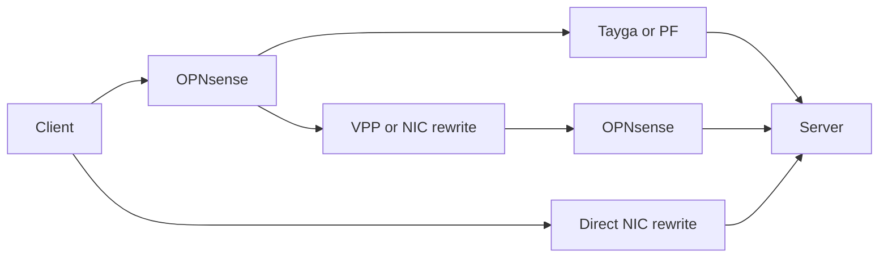

# MWAN packet forwarding performance

MWAN forwards packets in the guest kernel. Routes, policy rules, and nftables
rules do not send packet bytes to the daemon. A host bridge uses host CPU to
transfer packets between router and gateway guests. A NIC can instead switch
packets between hardware virtual functions assigned to separate containers.

Every CPU percentage uses the complete capacity of the experiment’s host.
Host CPU includes guest work, traffic generation, and other active host work.

OPNsense [requires disabled hardware offloads in IPS mode](https://docs.opnsense.org/manual/ips.html).
OPNsense [disables several NIC offloads by default](https://docs.opnsense.org/manual/interfaces_settings.html)
and [disables system-wide receive-side scaling by default](https://docs.opnsense.org/troubleshooting/performance.html).

## Attachment paths

The WAN attachment and the router attachment are independent. These diagrams
show PCI passthrough, virtual WAN, and host bridge attachment.

### ISP NIC passed to the gateway

PCI passthrough assigns the physical NIC to the gateway guest. The WAN
attachment does not use a host bridge for packet transfer.

### ISP NIC attached to the host

A virtual WAN attaches the ISP NIC to the host. The host transfers packets
between that NIC and the gateway guest.

### Router and gateway on one host bridge

Separate router and gateway guests use the host bridge for their shared
attachment. PCI passthrough on a WAN NIC does not remove this transfer.

In the architecture example, ISP-1 and ISP-2 use PCI passthrough. ISP-3 uses a
virtual WAN. Every packet between the router and gateway guests uses their
host bridge.

## Measurement on August 16, 2026

The upload measurements compare CPU use for routing and NAT inside the router
and gateway guests with the host CPU used to copy packets between those guests.

Test measurements:

| Measurement | Result |
| --- | ---: |
| Download | 693 Mbit/s |
| Upload | 1782 Mbit/s |
| Recorded host CPU capacity | 12 cores |
| Copy threads' share of combined guest work at upload peak | About 15% |

The CPU breakdown distinguishes guest processing from host packet copying.

Host CPU use:

| CPU use, % of entire host | Before test | Upload peak |
| --- | ---: | ---: |
| Router guest copy thread | 0.08% | 4.92% |
| Gateway guest copy thread | 0.08% | 4.33% |
| Both copy threads | 0.17% | 9.25% |
| Router guest forwarding | Not measured | 37.83% |
| Gateway guest forwarding | Not measured | 16.75% |
| Both guests forwarding | Not measured | 54.58% |
| Forwarding and copy threads | Not measured | 63.83% |

## Vault and PowerEdge translation performance

The comparison evaluates PowerEdge translation options against Vault's
installed OPNsense router under the recorded workload and CPU allocations.

Test conditions:

| Test condition | Value |
| --- | --- |
| Host CPU capacity | Vault: 12 logical CPUs; PowerEdge: 16 |
| OPNsense VM allocation | Vault: 33.33% of host CPU capacity; PowerEdge: 50.00% |
| Traffic | 8 clients; TCP: 4 streams each, uncapped; UDP: 1 stream each, 1400-byte payload, 5 Gbit/s per direction |
| Measured duration | 20 seconds; TCP excludes 3 seconds of warmup |
| Network | Vault uses its physical LAN; PowerEdge uses the NIC internal switch. |
| Traffic generator | iperf3 3.18 with synchronized UDP starts |
| Generator placement | PowerEdge runs both endpoints. Vault uses NAS as its client and runs the server locally. |
| Recorded PowerEdge WAN and LAN links | 10 Gbit/s full duplex each, from iDRAC NIC inventory. |
| PowerEdge NIC and drivers | Broadcom BCM57504; OPNsense uses a rebuilt Broadcom driver. The DPDK build includes the [submitted BNXT firmware-command fix](https://patches.dpdk.org/project/dpdk/patch/20261018022929.91865-1-alex@goodkind.io/). |
| PowerEdge software settings | TruFlow enabled; VF MSI-X capacity 16; OPNsense uses 8 queues and VPP uses 4. |
| NIC test settings | TruFlow enabled; VF MSI-X capacity 16; OPNsense uses 8 queues. |
| Hardware scope | Fixed address mappings, with a separate source address per client; PF NAT66 combines sources. The tested driver rejects NAT64. |
| VPP driver mode | VPP performs CPU translation and uses [app-id=255](https://github.com/DPDK/dpdk/blob/v26.03/drivers/net/bnxt/bnxt.h#L895-L896) to disable TruFlow for its interfaces. |
| Tayga UDP timing | Recorded interval: 46.57 s. Required interval: 18 to 22 s. |

Efficiency divides combined received Mbps by routing/translation CPU percentage
points, using the rounded measurements in the tables.

### TCP

TCP tests compare transfer capacity without a sender rate limit.

TCP throughput and CPU use:

| Host | Translation | Software | Received Gbit/s, forward / reverse | Routing / translation CPU | Total host CPU | Mbps per CPU percentage point |
| --- | --- | --- | --- | --- | --- | --- |
| Vault | NAT64 | Tayga | 0.93 / 0.35 | 36.90% | 75.69% | 35 |
| PowerEdge | NAT64 | Tayga | 1.28 / 1.48 | 49.63% | 63.39% | 56 |
| PowerEdge | NAT64 | OPNsense + VPP | 4.91 / 5.25 | 70.90% | 86.24% | 143 |
| Vault | NAT66 | PF | 2.35 / 0.28 | 28.97% | 71.33% | 91 |
| PowerEdge | NAT66 | PF | 10.22 / 11.29 | 48.62% | 72.74% | 442 |
| PowerEdge | NAT66 | OPNsense + VPP | 5.10 / 5.64 | 71.90% | 86.61% | 149 |
| PowerEdge | Fixed NAT66 | OPNsense + TruFlow | 6.27 / 5.92 | 48.54% | 65.28% | 251 |
| PowerEdge | Fixed NAT66 | TruFlow without OPNsense | 31.81 / 36.97 | 0.0065% | 96.25% | Controller only |
| Vault | NPT | PF BINAT | 2.33 / 0.22 | 28.95% | 72.02% | 88 |
| PowerEdge | NPT | PF BINAT | 10.10 / 10.86 | 48.41% | 71.20% | 433 |
| PowerEdge | NPT, RFC 6296 | OPNsense + VPP | 5.32 / 5.37 | 72.50% | 86.88% | 147 |
| PowerEdge | Fixed NPT | OPNsense + TruFlow | 6.44 / 5.74 | 48.39% | 65.08% | 252 |

### UDP

UDP tests compare packet delivery under the same requested load.

UDP throughput, loss, and CPU use:

| Host | Translation | Software | Sent Gbit/s | Received Gbit/s | Packets not received | Routing / translation CPU | Total host CPU | Mbps per CPU percentage point |
| --- | --- | --- | --- | --- | --- | --- | --- | --- |
| Vault | NAT64 | Tayga | Test failed | Test failed | Test failed | Not measured | Not measured | Not measured |
| PowerEdge | NAT64 | Tayga | Invalid timing | Invalid timing | Invalid timing | Not measured | Not measured | Not measured |
| PowerEdge | NAT64 | OPNsense + VPP | 5.00 / 5.00 | 1.03 / 1.16 | 79.35% / 76.79% | 70.34% | 98.54% | 31 |
| Vault | NAT66 | PF | 2.53 / 5.00 | 1.72 / 1.06 | 31.15% / 78.78% | 30.64% | 91.57% | 91 |
| PowerEdge | NAT66 | PF | 5.00 / 5.00 | 4.58 / 3.21 | 8.39% / 35.86% | 48.06% | 92.22% | 162 |
| PowerEdge | NAT66 | OPNsense + VPP | 5.00 / 5.00 | 2.88 / 1.11 | 42.11% / 77.84% | 68.36% | 98.59% | 58 |
| PowerEdge | Fixed NAT66 | OPNsense + TruFlow | 5.00 / 5.00 | 3.70 / 3.60 | 25.96% / 27.96% | 48.70% | 91.50% | 150 |
| PowerEdge | Fixed NAT66 | TruFlow without OPNsense | 5.00 / 5.00 | 4.99 / 4.99 | 0.13% / 0.16% | 0.0051% | 56.10% | Controller only |
| Vault | NPT | PF BINAT | 2.35 / 5.00 | 1.27 / 1.17 | 45.50% / 76.66% | 27.96% | 96.32% | 87 |
| PowerEdge | NPT | PF BINAT | 5.00 / 5.00 | 4.60 / 4.69 | 8.05% / 6.29% | 47.80% | 93.20% | 194 |
| PowerEdge | NPT, RFC 6296 | OPNsense + VPP | 5.00 / 5.00 | 2.57 / 2.75 | 48.60% / 45.04% | 65.57% | 98.42% | 81 |
| PowerEdge | Fixed NPT | OPNsense + TruFlow | 5.00 / 5.00 | 2.95 / 3.24 | 40.91% / 35.17% | 48.22% | 89.21% | 128 |

Rate pairs list simultaneous traffic from client to server and from server to
client, in that order. Routing/translation CPU combines OPNsense with its
external translator or NIC rule controller, except that the direct NIC test
counts only its controller.

PF BINAT replaces the prefix and updates checksums, while VPP applies the
different [RFC 6296 address calculation](https://www.rfc-editor.org/rfc/rfc6296.html).

## Remaining investigation

MWAN-527 tracks the forwarding comparison with a software bridge.
