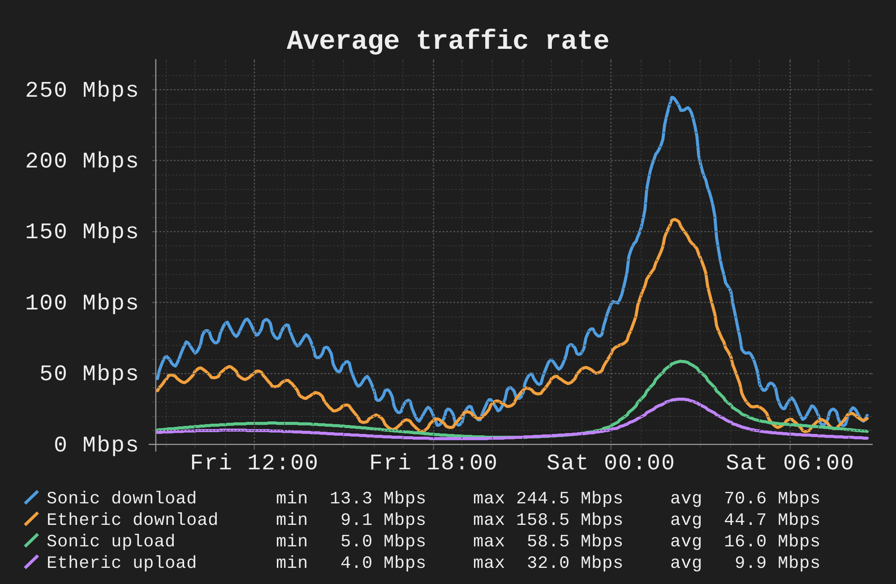

# MWAN reporting design

MWAN will collect network measurements on the Linux gateway and send daily reports and incident alerts through `goodkind.io/send-email/mailer`. The report preserves the approved sample v3 appearance and compares the configured WANs on shared graphs.

The approved sample uses fictional measurements. It establishes the font, solid line styles, units, colors, and legend layout.

## Daily report

The network graphs compare every configured WAN for which the relevant measurement exists. A separate combined CPU/RAM graph measures the Linux environment running the monitor.

Report graphs:

| Graph | Measurement | Period and grouping |
|---|---|---|
| Usage | Cumulative downloaded and uploaded data for each WAN, in GiB. | Match BerylAX: today and the preceding UTC days, with cumulative points from daily usage buckets. Include today's partial usage. |
| Average speed | Observed download and upload traffic for each WAN, in Mbps. | Show the report day and average each measurement interval. Do not run speed tests. |
| Latency | Gateway and Cloudflare response times for each WAN, in ms. | Show the report day, with separate target and IPv4/IPv6 series. |
| Packet loss | Lost gateway and Cloudflare probes for each WAN, in percent. | Use the latency graph's period and series identities. |
| CPU and RAM | Overall CPU, each visible logical CPU, and used RAM, in percent. | Show the report day using BerylAX's CPU and memory calculations. |

Preserve the approved sample's usage-total and measurement-period tables. Place a top-talker table for each WAN after the graphs. Rank clients by downloaded plus uploaded bytes during the report day. Include device identity, downloaded data, uploaded data, and top destinations. Preserve BerylAX's distinction between verified attribution and accounting gaps independently for each WAN.

A scheduled report covers the period from the preceding local report time through the current local report time. The initial collection period starts when collection begins and remains explicitly partial. Usage buckets follow UTC days independently of this report boundary.

Do not add tables for probe results or Google probe series. Retain the combined CPU/RAM graph and the standard `send-email` footer. Keep useful incident diagnostics as attachments.

## Graph appearance

Use native RRDtool for graph rendering. Go prepares the series and structured report content; `send-email` renders the email and delivers it. Do not copy the email template or implement another mail transport in MWAN.

The following settings preserve the approved appearance.

Graph settings:

| Setting | Required value |
|---|---|
| Native RRDtool | Version 1.11.0 or newer, with PNG rendering and Pango font support. |
| Font | Liberation Mono, with Liberation Mono Bold for titles. Verify that the renderer actually selects these fonts. |
| Native font settings | DEFAULT 9, TITLE 11, and LEGEND 7 in RRDtool font-size units. |
| Logical width | 500 CSS pixels. |
| Plot height | 240 CSS pixels, with additional space for the title and every legend row. |
| Logical image height | 278 plus 12 times the number of legend rows, in CSS pixels. |
| Raster scale | Render at four times the logical dimensions. Do not enlarge an existing PNG. |
| Line style | Solid, anti-aliased lines for every series. |
| Palette | Assign a distinct, readable color to every visible series. Reuse each series' color in the corresponding legend and across latency/loss graphs. |
| Approved palette colors | `#4F9DE0`, `#5BC88A`, `#F2A03D`, and `#C084FC`. |
| Units | Add GiB, Mbps, ms, or percent to axis tick labels and legend values. |
| Legend | Align the series names and minimum, maximum, and average columns. Show totals for cumulative usage. Keep every row inside the image. |
| Theme | Preserve BerylAX's dark background, light text, and subdued grid. |
| Missing samples | Draw gaps and identify unavailable series. Never replace missing measurements with healthy zero values. |

Two WANs with both address families produce separate gateway and Cloudflare lines for each family in the latency and loss graphs. Increase the image height for the additional legend rows while keeping the logical width and font sizes readable. Native RRDtool supports [axis formatting, fonts, zoom, and line legends](https://oss.oetiker.ch/rrdtool/doc/rrdgraph.en.html).

## Incident alerts

Concurrent WAN failures form one combined incident. An alert starts with **Current incident**, lists the affected WANs and signals, then uses a strong visible divider before **Other WANs for comparison**. Explicit text identifies the groups; color alone does not establish incident membership. The comparison graphs include every WAN and mark incident WANs in their legends.

Evaluate breaches independently for each WAN, target, and address family before deciding whether the combined incident is open. Add a newly affected WAN to the existing incident. Do not send a separate opening email for that WAN. Include membership changes in the next scheduled reminder. Close the combined incident after every affected WAN satisfies the existing recovery rule.

Keep gateway-local UDP/DNS counter failures distinct from an ISP-path failure. Identify a local failure explicitly in Current incident without blaming a WAN that the measurements do not implicate. A combined incident remains open while its local failure or any affected WAN still meets the breach rule.

Keep BerylAX's alert policy as the configurable default.

Default collection, reporting, and alert settings:

| Setting | Default |
|---|---|
| Fresh and persistent probe interval | One second. |
| Measurement interval | One minute. |
| Complete-minute minimum | 54 probe seconds. |
| Breach window | Five complete minutes. |
| Packet-loss breach | Greater than 1% within the breach window. |
| DNS-resolution-failure breach | Greater than 1% within the breach window. |
| Average-latency breach | At least 200 ms within the breach window. |
| Router-drop breach | At least 50 drops and a drop rate greater than 0.1% within the breach window. |
| UDP send failure or DNS receive drop | Any observed increase within the breach window. |
| Incident reminder | Every 15 minutes while open. |
| Recovery | 15 minutes without a breached window. |
| Mail deadline | 45 seconds. |
| Daily report | 20:00 America/Los_Angeles, using calendar-day boundaries across daylight-saving changes. |
| Usage history in the graph | Today and the preceding 29 UTC days, limited to available history. |
| Persistent-probe renewal | Every 15 minutes. |
| RRD sample step and heartbeat | 60 seconds and 120 seconds. |
| RRD retention | 1,440 minute samples, 744 hourly samples, and 730 daily samples. |

Preserve the fresh-versus-persistent probe distinction. Persistent probes expose an existing connection's behavior; fresh probes determine incident thresholds as they do in BerylAX. Incomplete startup minutes do not open or extend an incident. An unsupported address family remains explicitly unmeasured.

Store delivery state only after the transport accepts a message. Retry failed reports and alerts after the next complete minute, including after a monitor restart. Continue collecting while rendering or delivery runs. A manual daily-summary send does not close the running report day.

## Program and data ownership

Implement reporting inside the existing `mwan` binary with `mwan report watch` and `mwan report send`. Keep the existing go-makefile build. Do not create a second binary, a new repository, or another deployment framework.

WANCONFIG remains the source for WAN identities, interfaces, routing identities, and configured address-family behavior. The reporter reads the existing validated network configuration and observes runtime interface/source-address state. It does not install routes, firewall rules, sysctls, or offload rules.

Use the existing MWAN configuration loader for reporting settings and mail configuration. Reuse the existing logger and notification packages. Extend their message interface to accept `mailer.Message` with ordered content, inline PNGs, and attachments. Return delivery errors to reporting so its retry state reflects transport acceptance.

Use Linux interface counters for WAN totals and BerylAX's connection-tracking accounting approach for client/destination attribution. Preserve original client identity across translation and select the WAN from actual connection/routing identity. Do not infer each client's share from the configured load-balancing weights. Mark missing or incomplete attribution explicitly when the available counters cannot establish it.

Write reporting history into its own configured state directory. Keep per-WAN identities stable across interface renames. Preserve existing reporting history when another WAN is added. Port BerylAX's CPU/RAM collector for the monitor's Linux environment and enumerate its visible CPUs instead of assuming a router-specific core count. Do not rewrite BerylAX's RRD files or copy its device-specific routing, roaming, or OpenWrt service management.

Use the existing published `send-email` library for the entire message and retain its default footer. This work does not modify that library. Keep the MWAN changes in local Git commits.

## Acceptance and implementation choices

The implementation must demonstrate the following outcomes through public command or package entry points with actual RRDtool files, actual Linux network observations, and a local SMTP receiver.

- A daily report contains the shared network graphs, the combined CPU/RAM graph, and top-talker tables, without probe tables.
- Every rendered graph uses the selected font, explicit units, distinct solid lines, aligned legends, and the required physical/logical image sizes.
- Simultaneous failures generate one opening alert, reminders compare all WANs, and recovery waits for all incident WANs.
- A failed delivery does not discard pending reporting state, and a successful retry does not repeat an already acknowledged recipient.
- Unavailable address families, counter resets, and incomplete attribution remain distinct from healthy measurements.
- Existing MWAN commands and existing `send-email` callers retain their prior behavior.

The builder may choose private helper functions, state-file serialization details, and the palette beyond the approved sample colors. The builder must keep the specified public commands, ownership boundaries, measurement meanings, and appearance. Report the limits of accounting observed in the Linux test environment instead of claiming hardware-counter coverage without evidence.

This work ends with reviewed local commits and local verification. Publishing, PR creation, infrastructure changes, and deployment require a later request.
